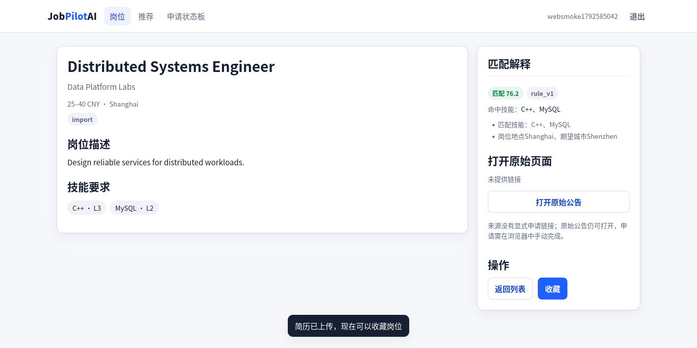
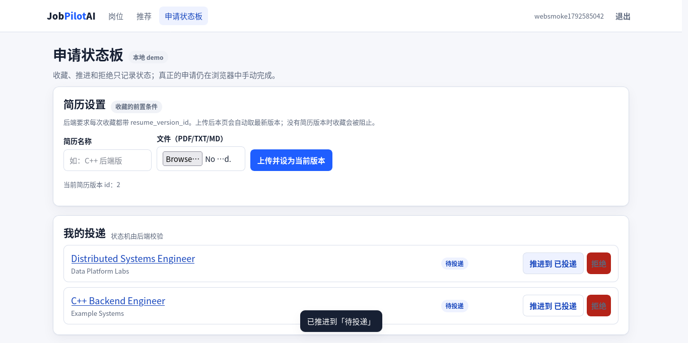

# JobPilotAI

**自托管、合规优先的求职工作台：采集公开招聘，理解匹配原因，跟踪投递进度，
但不自动提交申请。**

[English](README.md) | 简体中文

[](https://github.com/cjs1102/JobPilotAI/actions/workflows/ci.yml)
[](LICENSE)
[](https://github.com/cjs1102/JobPilotAI/releases/tag/v0.1.0)
[](CMakePresets.json)
[](docs/quality/README.md)



*岗位详情页展示确定性匹配分数、命中技能、匹配理由与否决项。当前界面文案为中文。*

<details>
<summary>申请状态板</summary>



*收藏和投递状态集中在本地状态板；真正的申请在原始页面完成。*

</details>

## 为什么

招聘网站擅长列出岗位，却很少解释“为什么值得投”。JobPilotAI 把公开招聘整理成
可检索的工作台，用确定性的 `rule_v1` 模型解释匹配，并把投递状态集中在一处。

它在“提交”之前停下：匹配可解释，简历定制只是带事实门禁的草稿，真正的申请会在
原始页面打开，由人复核。它不是批量自动投递机器人。

## 目录

[为什么](#为什么) · [功能](#功能) · [架构](#架构) ·
[快速开始](#快速开始) · [使用方式](#使用方式) ·
[验证](#验证) · [文档](#文档) · [路线图](#路线图) ·
[非目标](#非目标) · [贡献](#贡献) · [安全](#安全) · [许可证](#许可证) · [致谢](#致谢)

## 功能

- **采集公开招聘**：Greenhouse、Lever、Ashby、nowcoder 适配器，加上人工采集和
  JSON 导入。
- **搜索与筛选**：关键词、薪资、技能、地点、学历、岗位性质、截止时间和排序。
- **解释每一次匹配**：分数、命中/缺失技能、可加性理由、否决项和截止紧迫度。
- **生成简历草稿**：每条事实带来源标注，确认前必须通过机械事实门禁。
- **跟踪投递**：后端校验的状态机和本地申请状态板。
- **本地运行**：原生 HTML/CSS/JS 界面，无构建步骤；nginx 可选，Python 标准库
  代理作为回退。
- **AI 可选**：确定性路径不需要服务商密钥；Python AI Worker 提供任务型辅助。

## 架构

`backend/` 是 `jobpilot_core`（网络/HTTP、配置、日志、MySQL、Redis）。
`service/` 是业务层和可运行入口，按 Controller、Service、DAO 分层。Python 工具
不进入 C++ 服务进程。

```text
JobPilotAI/
├── backend/          # jobpilot_core：网络/HTTP、配置、日志、数据库、缓存
├── service/          # 业务层 + 可运行服务 + C++ 测试
├── source_adapters/  # 公开来源适配器与人工采集（Python）
├── ai_worker/        # 可选 AI 任务 Worker（Python）
├── web/              # 原生 HTML/CSS/JS 界面，无构建步骤
├── database/schema/  # MySQL 8 schema 与增量迁移
├── docker/           # nginx 静态托管配置
├── docs/             # 契约、ADR、质量、指南、阶段索引
└── tools/            # 演示、发布与验证工具
```

请求链路：

```text
浏览器 -> nginx（或 web_static_proxy.py） -> Router -> Controller -> Service -> DAO -> MySQL
                                                                  \-> Redis（会话）
```

C++ 服务通过基于 epoll 的 Reactor 处理 HTTP/1.1。P1 网络/HTTP 层行为冻结；修改
该层必须先获得明确的正确性计划批准。

## 快速开始

前置条件：Docker Engine 与 Compose v2、`curl`、Python 3。首次运行会构建后端
镜像，并拉取 MySQL 8 与 Redis 7。

```bash
git clone https://github.com/cjs1102/JobPilotAI.git
cd JobPilotAI
./tools/dev/demo-up.sh
```

启动脚本仅在 `.env` 不存在时生成随机密钥（权限 `0600`，不打印值），启动服务，
提供 UI，并导入 12 条合成岗位。成功时会打印：

```text
DEMO_READY url=http://127.0.0.1:8081
```

打开该地址。API 默认位于 `http://127.0.0.1:8080`。停止服务：

```bash
docker compose --env-file .env -p jobpilot-demo --profile app --profile web down
```

如果 `nginx:1.27-alpine` 不可用，`demo-up.sh` 会自动使用 Python 静态文件/代理
服务。加 `--no-seed` 可跳过示例岗位。完整排查见
[`docs/guides/local-demo.md`](docs/guides/local-demo.md)。

### 从源码构建（可选）

演示使用容器化后端。如需直接构建 C++ 服务，请安装 C++17 工具链、CMake、
`pkg-config` 和 MySQL 客户端开发文件，然后执行：

```bash
tools/dev/bootstrap.sh          # 解析固定的 Conan 依赖图
cmake --preset release
cmake --build --preset release -j"$(nproc)"
```

二进制位于 `build/presets/release/service/jobpilot_service`。Preset 与测试等级见
[`docs/quality/README.md`](docs/quality/README.md)。

## 使用方式

1. 注册本地账号；演示使用 HTTP 和浏览器 `localStorage`。
2. 收藏岗位前，先上传 PDF/TXT/Markdown 简历。
3. 搜索 `C++`，打开推荐视图，并使用筛选条件。
4. 阅读分数、命中/缺失技能、`reasons` 和 `deal_breakers`。
5. 收藏岗位，在申请状态板中推进状态。
6. 打开申请链接或原始公告，由本人手动完成申请。

演示数据是合成的，保存在本地 Docker 卷中。JobPilotAI 不会代你提交申请。

## 验证

- **321 个 C++ 测试**；Debug 全量完成 `321/321`，无失败且没有 Sanitizer
  诊断（开发数据库上有一个复核回填测试跳过；隔离临时库上通过）。最近一次
  完整 ASan/UBSan 矩阵是在新增 9 个测试之前的 `312/312`；受影响的 14 个测试
  在两种 Sanitizer 下均通过。
- **TSan**：测试框架 52/52，外部运行时 17/17，无诊断。TSan 不覆盖完整测试集。
- **Python**：来源适配器 481 个测试、AI Worker 190 个测试，在固定依赖环境中
  全部通过。
- **数据模型**：13 张 MySQL 表；**36 条路由**（27 条非内部，9 条内部）。
- **基准测试**（4 vCPU VMware，Release）：2 线程 / 32 连接下 **13,421.82
  请求/秒**，p99 **7.17 ms**。这是特定日期的特定主机测量值，不是阈值。
- **最新 main CI**（`c20795d`）：`ci` `39814999026`（11m55s）与 `image`
  `39814999046`（12m08s）均成功。

## 文档

| 主题 | 文档 |
|---|---|
| 从这里开始 | [`docs/README.md`](docs/README.md) |
| 概览、需求、架构 | [`docs/00-project-overview.md`](docs/00-project-overview.md)、[`docs/01-requirements.md`](docs/01-requirements.md)、[`docs/02-system-architecture.md`](docs/02-system-architecture.md) |
| 数据库与 API 契约 | [`docs/03-database-design.md`](docs/03-database-design.md)、[`docs/04-api-design.md`](docs/04-api-design.md) |
| 架构决策 | [`docs/adr/README.md`](docs/adr/README.md) |
| 编码与验证 | [`docs/06-coding-standard.md`](docs/06-coding-standard.md)、[`docs/quality/README.md`](docs/quality/README.md) |
| 本地演示与排查 | [`docs/guides/local-demo.md`](docs/guides/local-demo.md) |
| 基准测试 | [`docs/benchmarks/README.md`](docs/benchmarks/README.md) |
| 阶段历史 | [`docs/exec-plans/README.md`](docs/exec-plans/README.md) |
| 文档清单 | [`docs/PROJECT_DOCUMENTATION_INDEX.md`](docs/PROJECT_DOCUMENTATION_INDEX.md) |

## 路线图

以下是方向，不是承诺；均**尚未开始**。

- 验证并注册更多国内来源（Moka 目前未验证）。
- 在现有事实门禁之后增加服务商驱动的简历措辞。
- 为截止时间和状态变化增加本地通知。
- 为演示 UI 增加生产级认证与 TLS。

## 非目标

- 自动申请、代填表单或自动提交。
- 绕过登录墙、验证码、Cookie/UA 或代理池。
- 通用爬虫、消息队列、API 网关或多租户 SaaS。
- 承诺完整的来源覆盖；部分来源刻意保持有界。

## 贡献

提交 Pull Request 前请阅读 [`CONTRIBUTING.md`](CONTRIBUTING.md)。请在分支上工作，
附上相关测试或明确说明验证缺口，并遵守 P1 冻结。阶段历史见
[`docs/exec-plans/README.md`](docs/exec-plans/README.md)。

## 安全

请按 [`SECURITY.md`](SECURITY.md) 私下报告漏洞，不要为安全问题创建公开 Issue。
本地演示不是生产部署：它使用 HTTP 和浏览器存储，不应存放真实凭据或个人简历。

## 许可证

MIT。见 [`LICENSE`](LICENSE) 与 [`THIRD_PARTY_NOTICES.md`](THIRD_PARTY_NOTICES.md)。

## 致谢

使用 libbcrypt、nlohmann/json、hiredis、spdlog、yaml-cpp、GoogleTest 和 Conan
构建。第三方许可证与来源记录见
[`THIRD_PARTY_NOTICES.md`](THIRD_PARTY_NOTICES.md)。
