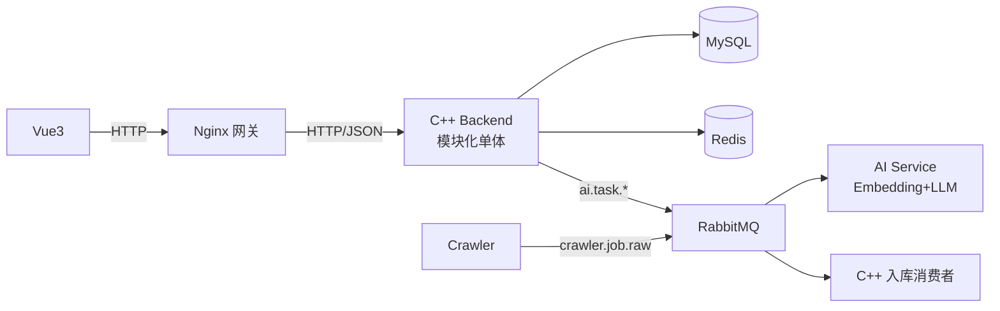

# JobPilot AI 项目总览

> 文档编号 00 · 状态 Accepted · 依据 ADR-0001~0005

## 一句话简介

JobPilot AI 是基于 **C++ 自研 HTTP Server（epoll/Reactor）** 与 **AI 大模型**构建的智能求职辅助平台，覆盖「岗位发现 → 岗位分析 → 简历优化 → 投递管理 → 面试准备」完整求职工作流，作为个人 C++ 后端能力展示项目开源。

## 项目背景

求职过程中存在：岗位信息分散、简历反复改版、投递记录难管理、缺少匹配度分析等问题。本项目用「岗位采集 + 岗位分析 + AI 辅助决策 + 投递管理」解决，并明确**不是**自动登录/自动投递招聘平台的违规工具。

## 项目目标

| 维度 | 目标 |
|---|---|
| 产品 | 形成完整求职工作流，可实际辅助求职 |
| 技术 | 展示 C++ 网络编程（epoll/Reactor）、数据库设计、并发、AI 工程化 |
| 工程 | CMake/Conan/Docker/CI 全流程，代码规范文档先行 |
| 交付 | 单人 3-6 个月，任何阶段可运行可演示 |

## 架构概览

> 详细架构见 [02-system-architecture.md](02-system-architecture.md)。

## 技术栈

| 层 | 技术 |
|---|---|
| 后端 | C++17 · CMake · Conan · epoll · Reactor · spdlog · GoogleTest |
| 数据 | MySQL 8 · Redis 7 · RabbitMQ |
| AI | Python · FastAPI · sentence-transformers(bge-small-zh) · DeepSeek/Qwen API |
| 采集 | Python · Scheduler/Spider/Parser/Pipeline |
| 前端 | Vue3 · Vite · Element Plus · ECharts（仅 1 张投递统计图）· Axios |
| 部署 | Docker · Docker Compose · GitHub Actions |

## 功能清单

| 模块 | 功能 |
|---|---|
| 用户 | 注册/登录/画像/技能管理 |
| 简历 | 上传/版本管理/文件存储 |
| 岗位 | 岗位管理/搜索/技能要求 |
| 投递 | 投递记录/状态机/统计 |
| AI | 异步岗位匹配/简历优化/面试助手（加分项） |
| 采集 | 数据集导入/爬虫（加分项） |
| 通知 | 投递/面试/AI 完成提醒 |

## 文档索引

| 编号 | 文档 | 说明 |
|---|---|---|
| 00 | [project-overview](00-project-overview.md) | 本文档 |
| 01 | [requirements](01-requirements.md) | 需求分析 V1.0 |
| 02 | [system-architecture](02-system-architecture.md) | 系统架构 V3.0 |
| 03 | [database-design](03-database-design.md) | 数据库设计 |
| 04 | [api-design](04-api-design.md) | 接口设计 |
| 05 | [development-plan](05-development-plan.md) | 开发计划（诚实分阶段） |
| 06 | [coding-standard](06-coding-standard.md) | 代码规范 |
| 07 | [deployment](07-deployment.md) | 部署文档 |
| **08** | **[execution-guide](08-execution-guide.md)** | **执行手册（唯一执行依据，V1.1）** |
| - | [adr/](adr/README.md) | 架构决策记录 0001-0006 |

## 开发原则（防止中途大改）

1. **文档先行**：本目录文档为唯一权威依据，代码严格遵循，禁止偏离后大改
2. **契约锁定**：`03` 表结构、`04` API 契约为硬约束，前端/后端/AI 三方以此为准
3. **顺序即优先级**：按 [05-development-plan.md](05-development-plan.md) 阶段推进，每阶段可演示
4. **止损优先**：卡点按止损线处理，不做无边界扩展
