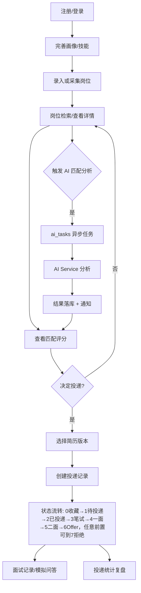
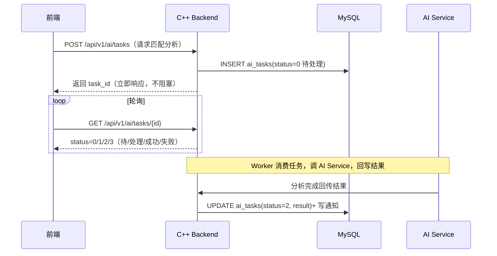
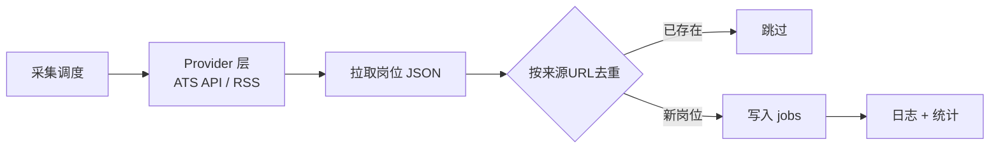

# JobPilot AI 需求分析文档 V1.0

> ⚠️ **历史资料 / Historical — Superseded**
>
> 本文档属于 ADR-0007 ~ ADR-0010 之前的旧设计方向，仅作历史参考，
> **不得作为新的实现规范**。现行架构见
> [architecture/open-source-mvp.md](architecture/open-source-mvp.md)，
> 现行决策见 [adr/README.md](adr/README.md)（ADR-0007 ~ ADR-0010）。
>
> Do not use this document for new implementation decisions.

> 文档编号 01 · 依据架构 V3.0 与 [ADR-0001~0005](adr/README.md) 编写。
> Historical / Superseded，不作为当前 MVP 实现依据；现行依据见
> [architecture/open-source-mvp.md](architecture/open-source-mvp.md) 与
> [adr/README.md](adr/README.md)（ADR-0007 ~ ADR-0010）。历史正文保留。

## 1. 项目背景

求职过程存在四大痛点：

1. **岗位信息分散**：岗位散布于多个招聘平台/企业招聘官网，手动搜集效率低、易遗漏
2. **简历反复改版**：每次投递都要针对岗位调整简历，缺少版本管理与结构化沉淀
3. **投递记录难管理**：投递了哪些、进度如何、何时该跟进，缺乏统一追踪
4. **缺少匹配度分析**：盲目投递，缺少"岗位-自身能力"的量化匹配判断

本项目用「岗位采集 → 岗位分析 → 简历优化 → 投递管理 → 面试准备」构建完整求职工作流，以 C++ 自研网络服务为核心，AI 大模型作为辅助决策能力，打造**个人可运行的求职辅助平台**。

> 合规红线（贯穿全项目）：**不做**自动登录招聘平台、**不做**自动投递；爬虫仅采集公开数据并遵守 robots.txt。详见 §5.5 与 §7。

## 2. 用户角色

| 角色 | 说明 | 核心诉求 |
|---|---|---|
| **普通用户（求职者）** | 项目的主要使用者，单人模式即自身 | 高效发现匹配岗位、优化简历、管理投递、准备面试 |
| **管理员** | 平台运营者（演示环境可为同一人） | 维护岗位数据源、查看系统健康、管理用户 |
| **系统任务** | 非交互角色，由系统自动执行 | 爬虫采集、AI 异步处理、通知推送 |

> 单人项目中"普通用户"即"我本人"，但权限模型按多用户设计（users 表 + 会话），保证代码可扩展、可演示多账号。

## 3. 用户故事

按 MoSCoW 分级：**M**=必须（MVP 前必须完成）、**S**=应该（MVP 后优先）、**C**=可以（可选加分项）。

### 3.1 用户模块

| ID | 用户故事 | 优先级 |
|---|---|---|
| US-101 | 作为求职者，我希望注册/登录，以便在多个设备安全使用平台 | M |
| US-102 | 作为求职者，我希望维护个人画像（目标岗位、经验、技能），以便 AI 与匹配功能有据可依 | M |
| US-103 | 作为求职者，我希望管理技能清单，以便精确表达能力集合 | S |

### 3.2 简历模块

| ID | 用户故事 | 优先级 |
|---|---|---|
| US-201 | 作为求职者，我希望上传简历并保存多个版本，以便跟踪每次投递所用的简历 | M |
| US-202 | 作为求职者，我希望查看简历历史版本，以便回滚或复用 | S |
| US-203 | 作为求职者，我希望 AI 按目标岗位给出简历优化建议（加分项） | C |

### 3.3 岗位模块

| ID | 用户故事 | 优先级 |
|---|---|---|
| US-301 | 作为求职者，我希望按关键词/地点/技能检索岗位，以便快速筛选 | M |
| US-302 | 作为求职者，我希望查看岗位详情与技能要求，以便评估匹配度 | M |
| US-303 | 作为求职者，我希望查看"岗位-我"的匹配评分与差距分析，以便决定是否投递 | S |

### 3.4 采集模块

| ID | 用户故事 | 优先级 |
|---|---|---|
| US-401 | 作为求职者，我希望通过导入公开数据集/手动录入批量录入岗位，以便在无爬虫时也能使用 | M |
| US-402 | 作为求职者，我希望系统自动从公开岗位源采集新岗位，以便减少手动搜集（加分项） | C |

### 3.5 投递模块

| ID | 用户故事 | 优先级 |
|---|---|---|
| US-501 | 作为求职者，我希望记录每次投递（岗位、使用的简历版本、投递日期），以便统一追踪 | M |
| US-502 | 作为求职者，我希望跟踪投递状态（收藏/待投递/已投/笔试/一面/二面/offer/拒绝，状态机见 02 §5.4），以便掌握进度 | M |
| US-503 | 作为求职者，我希望按状态/时间统计投递数据，以便复盘 | S |

### 3.6 AI 与面试模块

| ID | 用户故事 | 优先级 |
|---|---|---|
| US-601 | 作为求职者，我希望系统异步分析岗位匹配度并在完成后通知我，以便不阻塞操作 | S |
| US-602 | 作为求职者，我希望记录面试过程与问题，以便复盘改进 | S |
| US-603 | 作为求职者，我希望 AI 生成面试模拟问答（加分项） | C |

## 4. 功能需求

功能需求按模块组织，含功能点、输入/输出与验收标准。**FR 编号稳定，需求变更需评审并同步 00/02/03/04。**

### 4.1 用户模块（FR-1xx）

| ID | 功能 | 说明 | 优先级 |
|---|---|---|---|
| FR-101 | 注册 | 邮箱+密码注册，bcrypt 哈希存储 | M |
| FR-102 | 登录/登出 | Bearer Token 会话认证 | M |
| FR-103 | 画像管理 | 目标岗位/经验/技能 CRUD | M |
| FR-104 | 技能管理 | 技能增删改查 | S |
| FR-105 | 用户状态管理 | 禁用/启用（管理员） | S |

**验收标准**：注册后可用账号登录；密码不以明文存储（库中为 bcrypt 哈希）；未登录访问受保护接口返回 401。

### 4.2 简历模块（FR-2xx）

| ID | 功能 | 说明 | 优先级 |
|---|---|---|---|
| FR-201 | 简历上传 | 上传 PDF/TXT/MD，落盘存储 | M |
| FR-202 | 版本管理 | 每次上传生成新版本，支持列表/回滚 | M |
| FR-203 | 文件访问 | 鉴权后可下载指定版本 | M |

**验收标准**：同一简历多次上传产生递增版本号；投递记录可关联到具体简历版本；未授权不能下载他人简历。

### 4.3 岗位模块（FR-3xx）

| ID | 功能 | 说明 | 优先级 |
|---|---|---|---|
| FR-301 | 岗位检索 | 关键词/地点/技能组合过滤 + 分页 | M |
| FR-302 | 岗位详情 | 描述、要求、来源、发布时间 | M |
| FR-303 | 技能要求 | 岗位关联技能清单 | M |
| FR-304 | 岗位入库 | 支持手动/批量/采集三条入口 | M |

**验收标准**：`GET /api/v1/jobs` 支持关键词/地点/技能过滤，返回分页结构 `{list,total,page,page_size}`；同一岗位按来源 URL 去重（唯一键）。

### 4.4 采集模块（FR-4xx）

| ID | 功能 | 说明 | 优先级 |
|---|---|---|---|
| FR-401 | 数据集导入 | 导入公开岗位数据集（CSV/JSON），写入 jobs | M |
| FR-402 | 手动录入 | 用户手动添加单个岗位 | M |
| FR-403 | ATS 公开接口采集 | 从公开 ATS 岗位 JSON API + RSS 源定时采集（加分项） | C |
| FR-404 | 去重与活性 | 按来源 URL 去重；采集时跳过已存在岗位 | C |
| FR-405 | 采集调度 | 定时任务（如每日一次），可启停 | C |

**验收标准**：同一来源 URL 的岗位重复采集只保留一条；爬虫失败（网络/接口变更）不阻塞主服务，记录日志并可重试；采集全程免登录、遵守 robots.txt。

> 采集方案说明：**优先集成公开 ATS 岗位 API（Greenhouse / Lever / Ashby / Workday 等）与 RSS/JSON 订阅源**，而非抓取招聘网站 HTML。理由：免认证、免对抗反爬、schema 固定、稳定性高，且天然满足合规红线（无需登录，可校验 robots.txt）。HTML 抓取仅作为兜底且必须遵守 robots.txt，不做登录态采集。

### 4.5 AI 分析模块（FR-5xx）

| ID | 功能 | 说明 | 优先级 |
|---|---|---|---|
| FR-501 | 岗位匹配分析 | 基于用户画像+技能，LLM 打分岗位匹配度并给差距建议 | S |
| FR-502 | 简历优化建议 | 针对目标岗位给出简历优化建议（加分项） | C |
| FR-503 | 异步任务管理 | AI 任务经 `ai_tasks` 状态机异步执行，前端轮询结果 | S |
| FR-504 | 结果通知 | AI 完成后写通知，用户可查看 | S |

**验收标准**：调用 AI 后接口立即返回（不阻塞）；AI 失败任务状态落为失败并可重试；匹配结果包含评分与差距字段。

### 4.6 投递管理模块（FR-6xx）

| ID | 功能 | 说明 | 优先级 |
|---|---|---|---|
| FR-601 | 创建投递 | 关联岗位+简历版本+日期 | M |
| FR-602 | 状态流转 | 投递状态机 8 态：0收藏→1待投递→2已投递→3笔试→4一面→5二面→6Offer，任意前置可到 7拒绝（见 02 §5.4，非法迁移返回 40005） | M |
| FR-603 | 投递统计 | 按状态/时间聚合统计 | S |
| FR-604 | 投递提醒 | 长期无更新的投递提醒跟进 | C |

**验收标准**：投递状态只能按状态机允许的方向流转；统计接口返回按状态/时间分组的数据。

### 4.7 面试助手模块（FR-7xx）

| ID | 功能 | 说明 | 优先级 |
|---|---|---|---|
| FR-701 | 面试记录 | 记录面试公司/岗位/日期/过程/问题 | S |
| FR-702 | 模拟面试问答 | AI 生成针对目标岗位的面试题与参考回答（加分项） | C |

**验收标准**：面试记录 CRUD 正常；模拟问答为异步任务，结果可回看。

### 4.8 通知模块（FR-8xx）

| ID | 功能 | 说明 | 优先级 |
|---|---|---|---|
| FR-801 | 站内通知 | 投递状态变化、AI 完成等产生站内通知 | S |
| FR-802 | 通知列表/已读 | 通知查询与标记已读 | S |

**验收标准**：通知与业务事件解耦（业务写事件、通知模块消费）；已读状态持久化。

## 5. 非功能需求

### 5.1 性能（NFR-P）

| ID | 指标 | 目标 |
|---|---|---|
| NFR-P01 | 接口响应 | 非 AI 接口 P95 < 300ms（本地/单机演示环境） |
| NFR-P02 | 并发 | 单机支撑 1000+ 并发连接（epoll 模型演示） |
| NFR-P03 | AI 不阻塞 | AI 类请求接口立即返回，异步处理 |
| NFR-P04 | 采集不阻塞 | 爬虫与主服务解耦，采集异常不影响主流程 |

### 5.2 安全（NFR-S）

| ID | 要求 | 说明 |
|---|---|---|
| NFR-S01 | 密码哈希 | bcrypt，禁止明文/可逆存储 |
| NFR-S02 | 密钥管理 | 数据库密码/LLM Key 仅环境变量，不入 git/config |
| NFR-S03 | SQL 注入防护 | 所有 SQL 参数化，禁止字符串拼接 |
| NFR-S04 | 鉴权 | 受保护接口校验 Bearer Token，按用户隔离数据 |
| NFR-S05 | 越权防护 | 资源访问校验归属（用户只能访问自己的数据） |

### 5.3 扩展性（NFR-E）

| ID | 要求 | 说明 |
|---|---|---|
| NFR-E01 | 模块化单体 | 引擎 `jobpilot_core` 与业务 `jobpilot_server` 解耦，业务可独立扩展 |
| NFR-E02 | 数据源可插拔 | 岗位数据源按 Provider 模式扩展（新增源不改主逻辑） |
| NFR-E03 | AI 服务可替换 | AI Service 与后端 HTTP 协议耦合，可换模型/实现 |

### 5.4 维护性（NFR-M）

| ID | 要求 | 说明 |
|---|---|---|
| NFR-M01 | 文档先行 | `03`/`04` 为权威契约；`02` 已 Historical / Superseded |
| NFR-M02 | 单元测试 | 引擎核心模块（Buffer/HTTP 解析/Poller）有单测 |
| NFR-M03 | 日志 | 统一 spdlog，异常可定位 |
| NFR-M04 | 可部署 | Docker Compose 一键部署，任何阶段可演示 |

### 5.5 合规（NFR-C）

| ID | 红线 | 说明 |
|---|---|---|
| NFR-C01 | 不做自动投递 | 不登录招聘平台、不代填代投 |
| NFR-C02 | 爬虫合规 | 仅公开数据源，遵守 robots.txt |
| NFR-C03 | 不采集登录态数据 | 排除需账号登录的采集 |

## 6. 使用流程图

### 6.1 核心求职工作流

### 6.2 AI 异步处理时序

### 6.3 岗位采集流程（加分项）

## 7. 范围边界（明确不做）

| 不做项 | 原因 |
|---|---|
| 自动登录招聘平台 | 违规、风险高、无展示价值 |
| 自动投递/代填申请表 | 明确红线，见 NFR-C01 |
| 登录态爬虫（抓需登录的岗位数据） | 合规红线 |
| 微服务化/RPC | 单人项目过度设计（ADR-0002） |
| 重 RAG/向量数据库 | MVP 数据量小，检索无用武之地（ADR-0005） |
| 复杂前端 | C++ 后端岗面试不看前端，保留最小演示即可 |

## 8. 需求追踪表

| 需求域 | 对应模块 | 数据表（详见 03） | API（详见 04） |
|---|---|---|---|
| 用户 | 4.1 | users / profiles / skills | `/api/v1/users/*` |
| 简历 | 4.2 | resumes / resume_versions | `/api/v1/resumes` |
| 岗位 | 4.3 | jobs / job_requirements | `/api/v1/jobs` |
| 采集 | 4.4 | jobs | 爬虫侧（Python） |
| AI | 4.5 | ai_tasks / notifications | `/api/v1/ai/tasks` |
| 投递 | 4.6 | applications | `/api/v1/applications` |
| 面试 | 4.7 | interview_records | `/api/v1/interviews` |
| 通知 | 4.8 | notifications | `/api/v1/notifications` |
