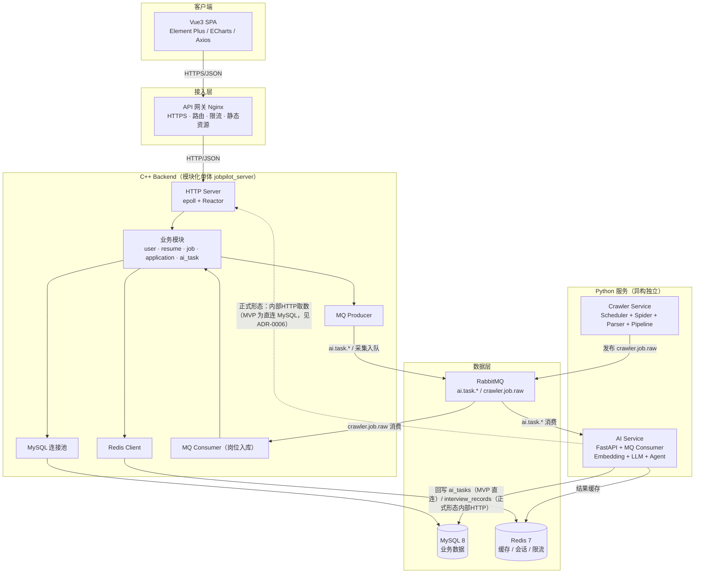
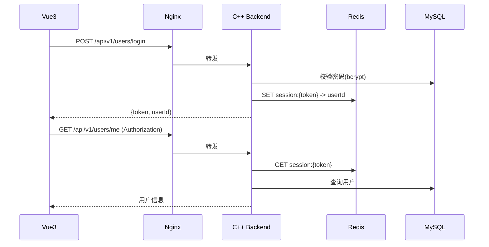
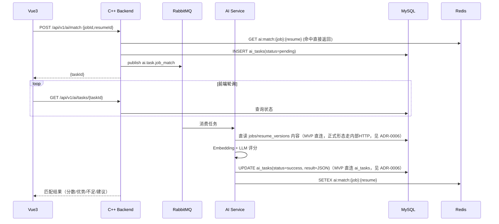
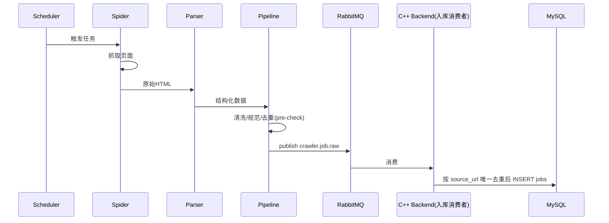
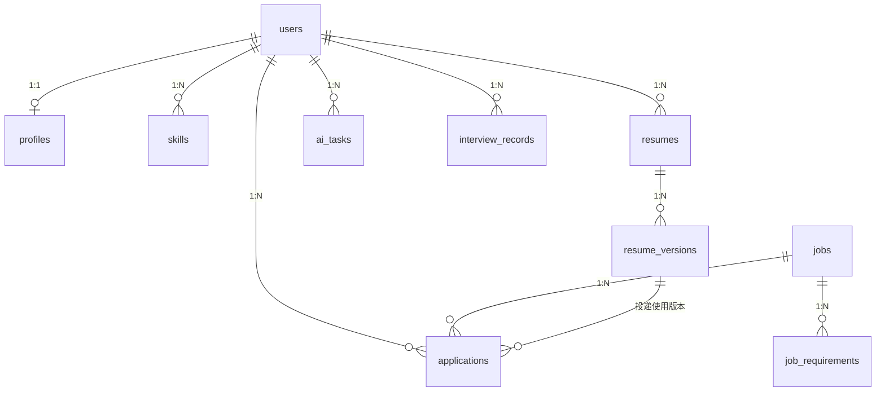
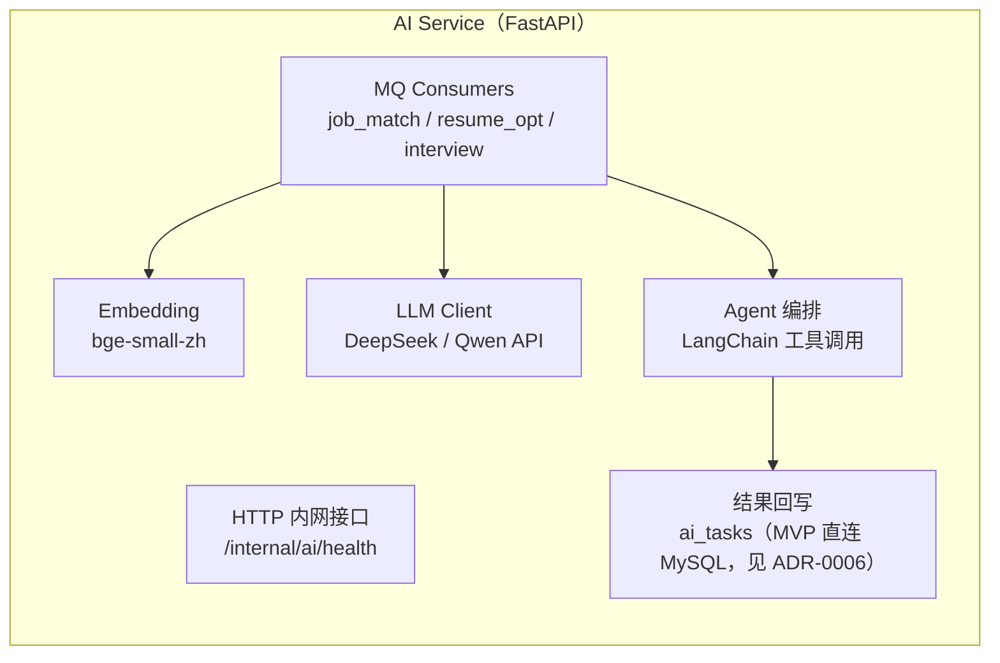
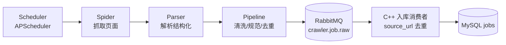
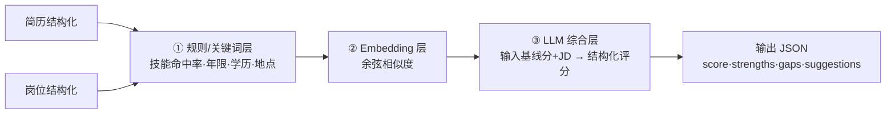
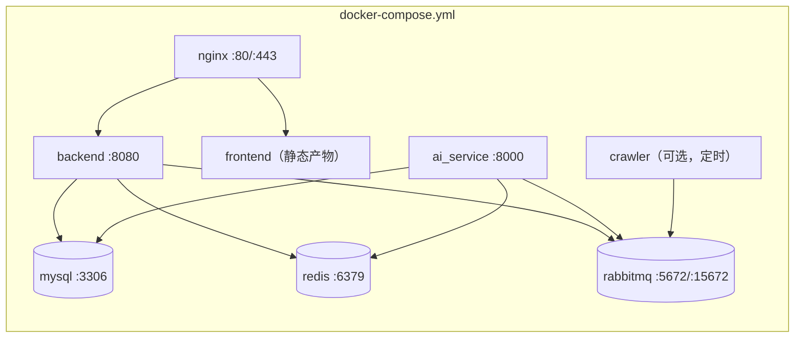

# JobPilot AI 系统架构设计文档 V3.0

> ⚠️ **历史资料 / Historical — Superseded**
>
> 本文档属于 ADR-0007 ~ ADR-0010 之前的旧设计方向，仅作历史参考，
> **不得作为新的实现规范**。现行架构见
> [architecture/open-source-mvp.md](architecture/open-source-mvp.md)，
> 现行决策见 [adr/README.md](adr/README.md)（ADR-0007 ~ ADR-0010）。
>
> Do not use this document for new implementation decisions.

> 依据 ADR-0001 ~ ADR-0006 修订。Historical / Superseded，不作为当前 MVP
> 实现依据；现行架构见
> [architecture/open-source-mvp.md](architecture/open-source-mvp.md)，现行决策见
> [adr/README.md](adr/README.md)（ADR-0007 ~ ADR-0010）。本文档曾用于替代早期
> V1.0（微服务）与 V2.0（单体总纲）中的冲突内容。

## 文档说明

| 项 | 值 |
|---|---|
| 项目 | JobPilot AI（智能求职辅助平台） |
| 架构基准 | 模块化单体 + 独立 Python 服务 + 消息队列解耦 |
| 面向 | C++ 后端岗位秋招展示，3-6 个月单人交付 |
| 关联 ADR | [ADR-0001](adr/0001-tech-stack.md) ~ [ADR-0006](adr/0006-ai-data-access.md) |
| 状态 | Accepted |

---

# 1. 设计目标与原则

## 1.1 目标

- 完整覆盖求职工作流：**岗位发现 → 岗位分析 → 简历优化 → 投递管理 → 面试准备**
- 展示 C++ 后端硬实力（epoll/Reactor、连接池、缓存、异步任务）
- 展示 AI 工程化能力（异步任务、可解释匹配、Agent 编排）
- 保证任何阶段都可运行、可部署、可演示

## 1.2 架构原则

1. **业务内聚**：核心 CRUD 在一个 C++ 进程内完成，事务由 MySQL 保证
2. **异步边界明确**：只有真正慢/易失败的负载（LLM、爬虫）才走消息队列
3. **异构即独立**：AI/爬虫因语言不同天然独立，不复制业务代码
4. **依赖向内**：Controller → Service → DAO，禁止跨模块引用实现
5. **深模块**：每个模块对外暴露小接口、内部承担复杂实现（见 codebase-design）
6. **可解释优先于炫技**：每一层设计都要能回答“为什么”

---

# 2. 总体架构图



**读图要点**：客户端 → 网关 → C++ 单体（业务处理 + 异步任务投递）→ 数据层；AI/爬虫与 C++ 单体平级，经 RabbitMQ 解耦。AI 数据访问：**MVP 阶段直连 MySQL 读写 ai_tasks 并直读 jobs/resume_versions（ADR-0006），正式形态经内部 HTTP 取数与回写，不直接跨服务访问业务库语义**。

---

# 3. 服务拆分

| 服务 | 语言 | 形态 | 职责 | 关键依赖 |
|---|---|---|---|---|
| **Gateway** | Nginx | 进程 | 路由、限流、HTTPS、前端静态托管、请求前置校验 | 无 |
| **C++ Backend** | C++17 | 模块化单体进程 | 全部业务：用户/简历/岗位/投递/AI任务管理 | MySQL、Redis、RabbitMQ |
| **AI Service** | Python | 独立进程 | 岗位匹配、简历优化、面试题、Agent 编排 | RabbitMQ、Embedding、LLM、内部HTTP |
| **Crawler Service** | Python | 独立进程 | 岗位采集、清洗、去重、入库 | RabbitMQ、Scheduler |
| MySQL | - | 数据层 | 业务主数据 | - |
| Redis | - | 数据层 | 会话、热点缓存、AI结果、限流 | - |
| RabbitMQ | - | 数据层 | 异步任务与采集解耦 | - |

## 3.1 C++ Backend 内部模块（进程内 bounded context）

| 模块 | 职责 | 主要数据表 |
|---|---|---|
| user | 注册/登录/Token/画像 | users, profiles, skills |
| resume | 简历上传、版本管理、解析 | resumes, resume_versions |
| job | 岗位管理、搜索、分类 | jobs, job_requirements |
| application | 投递记录、状态机、统计 | applications |
| ai_task | AI 任务编排、结果读取、缓存 | ai_tasks, interview_records |

> 模块间通过**进程内接口调用**，禁止互相 `#include` 实现；模块边界即未来拆分为进程的候选缝（seam）。

## 3.2 拆分取舍

- 业务模块**不拆进程**：单用户规模，拆进程只带来分布式一致性复杂度，无收益（ADR-0002）
- AI/爬虫**必须独立**：语言异构 + 异步负载特性（ADR-0002/0004）
- Gateway 用 **Nginx 而非自研**：网关能力（限流/HTTPS/静态）是成熟轮子，自研无展示价值

---

# 4. 数据流设计

## 4.1 用户请求主链路（登录）



## 4.2 AI 岗位匹配流程（异步）



## 4.3 岗位采集流程



## 4.4 数据一致性说明

- 业务 CRUD：同步 HTTP → MySQL，单库事务保证强一致
- AI/采集：异步 + 队列 + 幂等（`ai_tasks` 状态机 / `jobs.source_url` 唯一键），最终一致
- 缓存一致性：写库后主动失效 Redis 对应 key（Cache-Aside）

---

# 5. 数据库设计

> 详细 DDL 见 `03-database-design.md`，此处为架构级设计。

## 5.1 ER 关系概览



## 5.2 表清单与设计要点

| 表 | 用途 | 关键设计 |
|---|---|---|
| users | 账号 | `email` 唯一索引；`password_hash`(bcrypt)；`status` 软禁用 |
| profiles | 求职画像 | `user_id` 唯一索引(1:1)；技能拆 `skills` 表 |
| skills | 用户技能 | `(user_id, name)` 唯一；支撑匹配检索 |
| resumes | 简历主表 | 一个用户多份简历（C++版/游戏版） |
| resume_versions | 简历版本 | `(resume_id, version)` 唯一；存 file_path + content |
| jobs | 岗位 | `salary_min/salary_max` 数值化便于筛选；`source_url` 唯一防重复；`status` 有效/下线 |
| job_requirements | 岗位技能 | `(job_id, skill)` 唯一；匹配打分输入 |
| applications | 投递 | `(user_id, job_id)` 唯一防重复投递；`resume_version_id` 记录用哪个版本投的；状态机见 5.4 |
| ai_tasks | AI 任务 | 异步化地基；`(user_id, type, status)` 索引；`result` JSON |
| interview_records | 面试记录 | 面试助手问答持久化；`(user_id)` 索引 |
| notifications | 通知 | 投递/面试/AI完成提醒；`(user_id, status)` 索引 |

## 5.3 规范

- 引擎 `InnoDB`，字符集 `utf8mb4`，主键统一 `BIGINT UNSIGNED AUTO_INCREMENT`
- 所有业务表含 `create_time` / `update_time`
- 外键**不加物理约束**，由应用层保证（便于后续分库）
- 状态字段用 `TINYINT` + 代码层枚举，不用魔法数散落
- 冷热分离预留：ai_tasks 可归档；jobs 按 status 分区预留

## 5.4 投递状态机

```
0 收藏 → 1 待投递 → 2 已投递 → 3 笔试 → 4 一面 → 5 二面 → 6 Offer
                            ↘                     ↘
                             7 拒绝（任意前置状态可进入，终态）
```

状态迁移校验放 Service 层，非法迁移返回错误码。

---

# 6. Redis 设计

## 6.1 Key 规划

| Key | Type | TTL | 用途 |
|---|---|---|---|
| `session:{token}` | String | 24h | 会话（token → userId） |
| `job:hot` | ZSET | 5min | 热点岗位榜（score=浏览/收藏量） |
| `job:{id}` | String(JSON) | 10min | 岗位详情缓存 |
| `app:stats:{userId}` | Hash | 1min | 投递统计（总数/面试/Offer） |
| `ai:match:{jobId}:{resumeId}` | String(JSON) | 24h | AI 匹配结果缓存 |
| `rate:{userId}:{path}` | String(INCR) | 1min | 网关限流计数 |
| `lock:ai:task:{taskId}` | String | 30s | AI 任务消费分布式锁（防重复处理） |

## 6.2 策略

- **Cache-Aside**：读缓存 → 未命中读库 → 回填；写库后 DEL key
- **热点岗位**：定期重建 ZSET，避免热点 key 压力
- **AI 结果**：命中即免二次 LLM 调用（省成本 + 提速），TTL 24h
- **限流**：网关层 Redis INCR + EXPIRE，滑动窗口简化实现（固定窗口 + 均匀打点）
- 与 [ADR-0003](adr/0003-database-choice.md) 一致，不引入额外缓存组件

---

# 7. 消息队列设计

> 选型依据 [ADR-0004](adr/0004-message-queue.md)。

## 7.1 拓扑

```
                      ┌─ ai.task.job_match ──┐
 C++ Backend ────────►│ ai.task.resume_opt  ├──► AI Service
 (MQ Producer)        │ ai.task.interview   │
                      └──────────────────────┘

 Crawler Service ───► crawler.job.raw ──► C++ Backend(消费入库)
```

## 7.2 可靠性设计

| 项 | 方案 |
|---|---|
| 持久化 | exchange/queue/message 全 durable |
| 消费确认 | 手动 ACK；处理失败 NACK requeue |
| 幂等消费 | ai_tasks 状态机；jobs.source_url 唯一键 |
| 死信 | 重试超限进 DLX，定时补偿任务扫描 |
| 削峰 | 单消费者 QoS prefetch=1 |
| 降级 | C++ 发布失败回退写 `ai_tasks(status=pending)`，补偿扫描器兜底 |

## 7.3 消息体（示例）

```json
{
  "task_id": 1024,
  "type": "job_match",
  "user_id": 10001,
  "job_id": 20001,
  "resume_id": 30001,
  "created_at": "2026-08-09T10:00:00+08:00"
}
```

---

# 8. AI Agent 模块设计

> 依据 [ADR-0005](adr/0005-ai-agent-architecture.md)。

## 8.1 AI Service 内部结构



## 8.2 Agent 工具与工作流

| 工具 | 输入 | 输出 |
|---|---|---|
| JobSearchTool | 画像/关键词 | 岗位列表（经内部HTTP调 Job 模块） |
| JobAnalyzeTool | 简历 + 岗位 | 匹配分/优势/不足/建议 |
| ResumeOptimizeTool | 岗位 + 简历 | 优化版简历 + 建议 |
| InterviewGenTool | 岗位 + 技能 | 面试题 + 参考答案 |

**求职 Agent 编排流程**：读用户画像 → JobSearchTool 检索岗位 → 逐岗 JobAnalyzeTool 匹配 → 汇总生成推荐（Top-N + 理由）→ 写 notifications 通知用户。

## 8.3 约束

- 工具白名单固定，Agent 只能调这四个工具
- 单轮编排，不开放无限自主循环（避免失控与成本）
- 所有输出 JSON Schema 校验后落库

---

# 9. 爬虫系统设计

## 9.1 架构



## 9.2 职责划分

| 组件 | 职责 |
|---|---|
| Scheduler | 定时触发（如每日 09:00 增量采集），避免反爬高频 |
| Spider | 单页抓取 + 限速/重试；遵守 robots.txt |
| Parser | HTML → 结构化 Job 字段（公司/职位/地点/薪资/描述） |
| Pipeline | 清洗（薪资归一化）、规范（技能大小写）、去重预检、产出消息 |
| 入库消费者 | C++ 端消费，`source_url` 唯一去重后写入 |

## 9.3 合规与数据来源（分阶段）

| 阶段 | 来源 | 说明 |
|---|---|---|
| P1 | 公开数据集 / 用户导入（JSON/CSV/Excel） | 默认路径，零风险 |
| P2 | 企业招聘官网（静态公开页） | 遵守 robots.txt、限速，不做登录态采集 |
| 明确排除 | 招聘平台自动登录/自动投递 | 法律与风控红线 |

---

# 10. 简历匹配系统设计

## 10.1 可解释三层评分管线



| 层 | 作用 | 说明 |
|---|---|---|
| ① 规则层 | 可解释基线分（0-100） | 技能/年限/学历/地点命中，规则透明，无成本 |
| ② Embedding 层 | 语义相似度 | 简历全文 vs 岗位全文 embedding 余弦，捕捉语义匹配 |
| ③ LLM 层 | 综合评分 + 建议 | 把基线分 + JD 交给 LLM，输出结构化 {score, strengths, gaps, suggestions} |

## 10.2 为什么不用完整 RAG / 向量库

- 匹配是“简历 vs 岗位”的**单点比较**，不涉及大规模检索
- 数据量（个人自用）下向量库无收益，反增运维
- 规则层提供可解释性，这是纯 RAG 黑盒给不了的
- 详见 [ADR-0005](adr/0005-ai-agent-architecture.md)

## 10.3 一致性

- 结果 JSON 落 `ai_tasks.result`，缓存 Redis `ai:match:{job}:{resume}`，前端轮询读取
- 简历/岗位任一更新，失效对应缓存

---

# 11. 部署架构

## 11.1 开发环境（docker-compose，一键启动）



## 11.2 环境拆分

| 环境 | 形态 | 用途 |
|---|---|---|
| 开发 | docker-compose 全组件 + 本地热更 | 日常开发 |
| 演示 | 单云服务器 docker-compose | 面试/作品展示 |
| CI | GitHub Actions：build + 单测 + 镜像构建 | 质量门禁 |

## 11.3 运维要点

- 数据卷持久化：`mysql_data`、`redis_data`、`storage`（简历文件）
- 健康检查：各服务 `/health`，compose `depends_on: condition`
- 日志：spdlog 落卷 + AI 侧结构化日志
- 配置：`config.yaml` + 环境变量注入，密钥不入库
- 备份：`mysqldump` 定时 + 简历卷快照

---

# 12. 演进路径（预留缝）

| 触发条件 | 演进动作 |
|---|---|
| 岗位数据量过万 | 引入 ES 做全文搜索（替换 LIKE） |
| AI 调用成本上升 | 本地 Ollama + embedding 缓存降级 |
| 简历文件增多 | 对象存储替换本地磁盘 |
| 模块膨胀 | 沿 user/resume/job/application 边界拆进程，HTTP 替代进程内调用 |
| 采集量增大 | 爬虫独立分片 + 增量水位线 |

---

## 版本记录

| 版本 | 说明 | 日期 |
|---|---|---|
| V1.0 | 微服务方案（已废弃，见 ADR-0002） | - |
| V2.0 | 模块化单体总纲（本文档前身） | 2026-08-09 |
| V3.0 | 基于 ADR-0001~0005 的企业级定稿 | 2026-08-09 |
