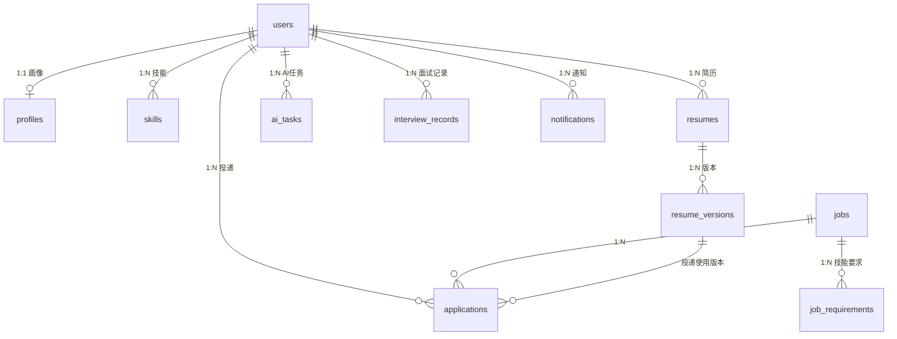

# JobPilot AI 数据库设计文档 V2.0

> 依据架构 V3.0 与 [ADR-0003](adr/0003-database-choice.md) 编写。本文档是当前 database contract authority，数据库字段、索引和迁移语义以本文档为准。

## 1. 数据库总览

| 项 | 值 |
|---|---|
| 引擎 | MySQL 8.0 |
| 库名 | `jobpilot` |
| 字符集 | `utf8mb4` |
| 排序规则 | `utf8mb4_general_ci` |
| 表数量 | 11 |

## 2. ER 关系



## 3. 建表 DDL（锁定版）

```sql
CREATE DATABASE IF NOT EXISTS jobpilot
  DEFAULT CHARACTER SET utf8mb4
  COLLATE utf8mb4_general_ci;

USE jobpilot;

-- ============ 用户域 ============

CREATE TABLE users (
    id            BIGINT UNSIGNED AUTO_INCREMENT PRIMARY KEY COMMENT '用户ID',
    username      VARCHAR(64)  NOT NULL COMMENT '用户名',
    email         VARCHAR(128) NOT NULL COMMENT '邮箱（登录账号）',
    password_hash VARCHAR(255) NOT NULL COMMENT 'bcrypt密码哈希',
    avatar        VARCHAR(255) DEFAULT NULL COMMENT '头像URL',
    status        TINYINT      NOT NULL DEFAULT 1 COMMENT '1正常 0禁用',
    create_time   DATETIME     NOT NULL DEFAULT CURRENT_TIMESTAMP,
    update_time   DATETIME     NOT NULL DEFAULT CURRENT_TIMESTAMP ON UPDATE CURRENT_TIMESTAMP,
    UNIQUE KEY uk_email (email),
    KEY idx_username (username)
) ENGINE=InnoDB DEFAULT CHARSET=utf8mb4 COMMENT='用户账号';

CREATE TABLE profiles (
    id              BIGINT UNSIGNED AUTO_INCREMENT PRIMARY KEY COMMENT '主键',
    user_id         BIGINT UNSIGNED NOT NULL COMMENT '用户ID',
    target_position VARCHAR(128) DEFAULT NULL COMMENT '目标岗位',
    experience      VARCHAR(64)  DEFAULT NULL COMMENT '经验描述',
    location        VARCHAR(64)  DEFAULT NULL COMMENT '期望城市',
    salary_min      INT UNSIGNED DEFAULT NULL COMMENT '期望月薪下限(千元)',
    salary_max      INT UNSIGNED DEFAULT NULL COMMENT '期望月薪上限(千元)',
    summary         TEXT         DEFAULT NULL COMMENT '自我评价',
    education_level TINYINT      DEFAULT NULL COMMENT '最高学历 1不限/2大专/3本科/4硕士/5博士(与 jobs.education_required 同枚举，0015)',
    graduation_year SMALLINT     DEFAULT NULL COMMENT '毕业年份 1990..2100，NULL=未知(0015)',
    campus_status   TINYINT      DEFAULT NULL COMMENT '1非应届/2应届/3在校，NULL=未知(0015)',
    create_time     DATETIME     NOT NULL DEFAULT CURRENT_TIMESTAMP,
    update_time     DATETIME     NOT NULL DEFAULT CURRENT_TIMESTAMP ON UPDATE CURRENT_TIMESTAMP,
    UNIQUE KEY uk_user_id (user_id),
    KEY idx_location (location)
) ENGINE=InnoDB DEFAULT CHARSET=utf8mb4 COMMENT='用户求职画像(1:1)';

CREATE TABLE skills (
    id          BIGINT UNSIGNED AUTO_INCREMENT PRIMARY KEY COMMENT '主键',
    user_id     BIGINT UNSIGNED NOT NULL COMMENT '用户ID',
    name        VARCHAR(64)  NOT NULL COMMENT '技能名',
    level       TINYINT      NOT NULL DEFAULT 1 COMMENT '1了解 2熟悉 3精通',
    create_time DATETIME     NOT NULL DEFAULT CURRENT_TIMESTAMP,
    UNIQUE KEY uk_user_skill (user_id, name),
    KEY idx_user (user_id)
) ENGINE=InnoDB DEFAULT CHARSET=utf8mb4 COMMENT='用户技能';

-- ============ 简历域 ============

CREATE TABLE resumes (
    id          BIGINT UNSIGNED AUTO_INCREMENT PRIMARY KEY COMMENT '简历ID',
    user_id     BIGINT UNSIGNED NOT NULL COMMENT '所属用户',
    title       VARCHAR(128) NOT NULL COMMENT '简历名称(如C++后端版)',
    create_time DATETIME     NOT NULL DEFAULT CURRENT_TIMESTAMP,
    update_time DATETIME     NOT NULL DEFAULT CURRENT_TIMESTAMP ON UPDATE CURRENT_TIMESTAMP,
    KEY idx_user (user_id)
) ENGINE=InnoDB DEFAULT CHARSET=utf8mb4 COMMENT='简历主表';

CREATE TABLE resume_versions (
    id          BIGINT UNSIGNED AUTO_INCREMENT PRIMARY KEY COMMENT '版本ID',
    resume_id   BIGINT UNSIGNED NOT NULL COMMENT '简历ID',
    version     INT            NOT NULL COMMENT '版本号(自增)',
    file_path   VARCHAR(255) DEFAULT NULL COMMENT '文件路径',
    content     MEDIUMTEXT   DEFAULT NULL COMMENT '解析后的文本内容',
    create_time DATETIME     NOT NULL DEFAULT CURRENT_TIMESTAMP,
    UNIQUE KEY uk_resume_version (resume_id, version),
    KEY idx_resume (resume_id)
) ENGINE=InnoDB DEFAULT CHARSET=utf8mb4 COMMENT='简历版本';

-- ============ 岗位域 ============

CREATE TABLE jobs (
    id             BIGINT UNSIGNED AUTO_INCREMENT PRIMARY KEY COMMENT '岗位ID',
    company        VARCHAR(128) NOT NULL COMMENT '公司',
    title          VARCHAR(128) NOT NULL COMMENT '职位',
    location       VARCHAR(64)  DEFAULT NULL COMMENT '地点',
    salary_min     INT UNSIGNED DEFAULT NULL COMMENT '月薪下限(千元)',
    salary_max     INT UNSIGNED DEFAULT NULL COMMENT '月薪上限(千元)',
    salary_currency VARCHAR(8)   NOT NULL DEFAULT 'CNY' COMMENT '币种',
    description    TEXT         DEFAULT NULL COMMENT '岗位描述',
    source         VARCHAR(32)  NOT NULL DEFAULT 'manual' COMMENT 'manual/import/crawler 或 allowlist 观测来源标识(0014)',
    source_url     VARCHAR(255) DEFAULT NULL COMMENT '来源链接(去重键)',
    status         TINYINT      NOT NULL DEFAULT 1 COMMENT '1有效 0下线',
    source_scope   VARCHAR(128) DEFAULT NULL COMMENT '来源 board/scope 标识(0012)',
    external_id    VARCHAR(255) DEFAULT NULL COMMENT '来源侧岗位ID(0012)',
    published_at   DATETIME     DEFAULT NULL COMMENT '来源发布时间(0012)',
    last_seen_at   DATETIME     DEFAULT NULL COMMENT '最近一次完整观测到的时间(0012)',
    last_verified_at DATETIME   DEFAULT NULL COMMENT '最近一次存活校验时间(0012)',
    closed_at      DATETIME     DEFAULT NULL COMMENT '软关闭时间(0012)',
    missing_count  INT          NOT NULL DEFAULT 0 COMMENT '连续完整观测缺失次数(0012)',
    source_status  VARCHAR(32)  NOT NULL DEFAULT 'unknown' COMMENT 'unknown/ok/missing/closed(0012)',
    education_required   TINYINT   DEFAULT NULL COMMENT '最低学历:1不限/2大专/3本科/4硕士/5博士(0014)',
    experience_years_min SMALLINT  DEFAULT NULL COMMENT '最低经验年限(0014)',
    experience_years_max SMALLINT  DEFAULT NULL COMMENT '最高经验年限(0014)',
    job_nature           TINYINT   DEFAULT NULL COMMENT '岗位性质:1校招/2社招/3实习(0014)',
    deadline             DATETIME  DEFAULT NULL COMMENT '投递截止时间(UTC瞬时;格式约定见§9.1,0014)',
    deadline_date_only   TINYINT   DEFAULT NULL COMMENT 'deadline是否仅来源日期:1是/0否/NULL未知(0014)',
    create_time    DATETIME     NOT NULL DEFAULT CURRENT_TIMESTAMP,
    update_time    DATETIME     NOT NULL DEFAULT CURRENT_TIMESTAMP ON UPDATE CURRENT_TIMESTAMP,
    UNIQUE KEY uk_source_url (source_url),
    KEY idx_company (company),
    KEY idx_title (title),
    KEY idx_location (location),
    KEY idx_status (status),
    KEY idx_source_scope_status (source, source_scope, status)
) ENGINE=InnoDB DEFAULT CHARSET=utf8mb4 COMMENT='岗位';

CREATE TABLE job_requirements (
    id          BIGINT UNSIGNED AUTO_INCREMENT PRIMARY KEY COMMENT '主键',
    job_id      BIGINT UNSIGNED NOT NULL COMMENT '岗位ID',
    skill       VARCHAR(64) NOT NULL COMMENT '技能名',
    level       TINYINT     NOT NULL DEFAULT 1 COMMENT '要求等级',
    create_time DATETIME    NOT NULL DEFAULT CURRENT_TIMESTAMP,
    UNIQUE KEY uk_job_skill (job_id, skill),
    KEY idx_job (job_id)
) ENGINE=InnoDB DEFAULT CHARSET=utf8mb4 COMMENT='岗位技能要求';

-- ============ 投递域 ============

CREATE TABLE applications (
    id                 BIGINT UNSIGNED AUTO_INCREMENT PRIMARY KEY COMMENT '投递ID',
    user_id            BIGINT UNSIGNED NOT NULL COMMENT '用户',
    job_id             BIGINT UNSIGNED NOT NULL COMMENT '岗位',
    resume_version_id  BIGINT UNSIGNED DEFAULT NULL COMMENT '使用的简历版本',
    status             TINYINT      NOT NULL DEFAULT 0 COMMENT '0收藏 1待投递 2已投递 3笔试 4一面 5二面 6Offer 7拒绝',
    apply_time         DATETIME     DEFAULT NULL COMMENT '投递时间',
    remark             TEXT         DEFAULT NULL COMMENT '备注',
    create_time        DATETIME     NOT NULL DEFAULT CURRENT_TIMESTAMP,
    update_time        DATETIME     NOT NULL DEFAULT CURRENT_TIMESTAMP ON UPDATE CURRENT_TIMESTAMP,
    UNIQUE KEY uk_user_job (user_id, job_id),
    KEY idx_user_status (user_id, status)
) ENGINE=InnoDB DEFAULT CHARSET=utf8mb4 COMMENT='投递记录';

-- ============ AI 域 ============

CREATE TABLE ai_tasks (
    id          BIGINT UNSIGNED AUTO_INCREMENT PRIMARY KEY COMMENT '任务ID',
    user_id     BIGINT UNSIGNED NOT NULL COMMENT '用户',
    task_type   VARCHAR(32) NOT NULL COMMENT 'job_match/resume_optimize/interview_gen',
    job_id      BIGINT UNSIGNED DEFAULT NULL COMMENT '关联岗位',
    resume_id   BIGINT UNSIGNED DEFAULT NULL COMMENT '关联简历',
    status      TINYINT NOT NULL DEFAULT 0 COMMENT '0pending 1processing 2success 3failed',
    result      JSON DEFAULT NULL COMMENT '结果JSON',
    error_msg   VARCHAR(512) DEFAULT NULL COMMENT '失败原因',
    retry_count INT NOT NULL DEFAULT 0 COMMENT '重试次数',
    locked_by       VARCHAR(64) DEFAULT NULL COMMENT '当前worker标识(0013)',
    lease_expire_at DATETIME    DEFAULT NULL COMMENT '租约到期时间(0013)',
    rule_result     JSON        DEFAULT NULL COMMENT '确定性规则基线结果(0013)',
    create_time DATETIME NOT NULL DEFAULT CURRENT_TIMESTAMP,
    update_time DATETIME NOT NULL DEFAULT CURRENT_TIMESTAMP ON UPDATE CURRENT_TIMESTAMP,
    KEY idx_user_status (user_id, status),
    KEY idx_status (status),
    KEY idx_type_status (task_type, status),
    KEY idx_status_lease (status, lease_expire_at)
) ENGINE=InnoDB DEFAULT CHARSET=utf8mb4 COMMENT='AI异步任务';

CREATE TABLE interview_records (
    id               BIGINT UNSIGNED AUTO_INCREMENT PRIMARY KEY COMMENT '记录ID',
    user_id          BIGINT UNSIGNED NOT NULL COMMENT '用户',
    job_id           BIGINT UNSIGNED DEFAULT NULL COMMENT '关联岗位(可空)',
    question         TEXT NOT NULL COMMENT '面试问题',
    user_answer      TEXT DEFAULT NULL COMMENT '用户回答',
    reference_answer TEXT DEFAULT NULL COMMENT '参考答案',
    skill_tag        VARCHAR(64) DEFAULT NULL COMMENT '技能标签',
    create_time      DATETIME NOT NULL DEFAULT CURRENT_TIMESTAMP,
    KEY idx_user (user_id)
) ENGINE=InnoDB DEFAULT CHARSET=utf8mb4 COMMENT='AI面试记录';

-- ============ 通知域 ============

CREATE TABLE notifications (
    id          BIGINT UNSIGNED AUTO_INCREMENT PRIMARY KEY COMMENT '通知ID',
    user_id     BIGINT UNSIGNED NOT NULL COMMENT '用户',
    title       VARCHAR(128) NOT NULL COMMENT '标题',
    content     TEXT DEFAULT NULL COMMENT '内容',
    status      TINYINT NOT NULL DEFAULT 0 COMMENT '0未读 1已读',
    create_time DATETIME NOT NULL DEFAULT CURRENT_TIMESTAMP,
    KEY idx_user_status (user_id, status)
) ENGINE=InnoDB DEFAULT CHARSET=utf8mb4 COMMENT='通知';
```

## 4. 设计决策说明

| 决策 | 理由 |
|---|---|
| `resumes` 不存 `current_version` | 用 `MAX(version)` 推导，避免双写不一致 |
| `applications` 引用 `resume_version_id` | 记录"用哪个版本投的"，可追溯 |
| `(user_id, job_id)` 唯一 | 同一用户对同一岗位只有一条投递，收藏→投递走状态流转 |
| `jobs.source_url` 唯一 | 爬虫/导入去重键（NULL 值在 MySQL 唯一索引中允许多个，不影响手工岗位） |
| 薪资数值化 `salary_min/max` | 支持按薪资区间筛选（VARCHAR 薪资无法排序） |
| 状态用 `TINYINT` + 注释 | 代码层枚举对应，禁魔法数 |
| 不加物理外键 | 应用层保证一致性，便于后续拆分/归档 |
| `ai_tasks.result` 用 JSON | 结果结构随功能演进，免改表 |

## 5. 索引策略

| 表 | 查询模式 | 索引 |
|---|---|---|
| users | 按 email 登录 | `uk_email` |
| profiles | 按 user 查画像 | `uk_user_id` |
| applications | 按用户×状态列表 | `idx_user_status` |
| jobs | 按公司/地点/状态过滤；按来源 scope 观测 | `idx_company` `idx_location` `idx_status` `idx_source_scope_status` |
| ai_tasks | 用户查任务 + Worker 捞待办 + 租约扫描 | `idx_user_status` `idx_status` `idx_type_status` `idx_status_lease` |
| notifications | 用户查未读 | `idx_user_status` |

> 0014 的 6 个新列（`education_required` / `experience_years_*` / `job_nature` /
> `deadline` / `deadline_date_only`）在 0014 阶段**不新增索引**（计划曾提议
> `idx_job_nature_education`，按确认决定延后）。**0015A 改变了这一决定**：新增
> `idx_deadline (deadline)`（服务于 `deadline ASC, id ASC` 排序，EXPLAIN 实测由
> filesort 180 ms 降为索引扫描 0.13 ms）与 `idx_review_status (review_status, id)`
> （队列扫描 + 公共可见性谓词）；`idx_job_nature_education` 仍**不加**——真实分布下
> 优化器不选它（`FORCE INDEX` 才更快），按「无证据不加索引」处理。三个焦点字段
> （`education_required` / `job_nature` / `deadline`）已进入检索/排序消费，详见 §9.2
> 的索引决定与 `docs/04` §5.1。其中 `deadline_date_only` 是 F13 落地时派生的
> 类型标志（见 §9.1/§9.6）。

> 岗位搜索初期用 `LIKE '%kw%'`，数据量大后引入全文索引或 ES（见架构文档 §12 演进路径）。

> 0015 A2 的三个 `profiles` 新列（`education_level` / `graduation_year` /
> `campus_status`）**不新增索引**：`profiles` 只按 `user_id` 读取，`uk_user_id`
> 已覆盖，本阶段没有任何按这三列过滤的查询（候选匹配组件属阶段 B，届时如需
> 过滤再以 `EXPLAIN` 证据决定）。详见 §10。

## 6. 数据初始化

- `database/schema/` 挂载到容器 `docker-entrypoint-initdb.d`，首次启动自动建表
- 种子数据尚未纳入当前 P0 schema；后续引入时必须保持幂等
- 建表脚本均为 `CREATE TABLE IF NOT EXISTS`，可重复执行；**既有库加列走 §7.3 起的
  编号 ALTER 增量块，不幂等——重复执行会报 duplicate column，属预期行为**
- 从零建库（容器化/手工两条路径）、既有库升级步骤、表数量校验与数据隔离规则见
  [`database/schema/README.md`](../database/schema/README.md)

## 7. 0012 Additive Freshness Migration Contract（增量契约）

本节登记 0012 Job Source Adapter + Freshness 的**增量字段契约**。
该契约已作为 0012 Step 1 落地：列与索引已写入 §3 建表 DDL 与
`database/schema/03_job.sql`（新库由初始化脚本直接创建）。

对齐来源：
[`exec-plans/completed/0012-job-source-adapter-freshness.md`](exec-plans/completed/0012-job-source-adapter-freshness.md) §8
与 [`adr/0010-job-freshness-and-lifecycle.md`](adr/0010-job-freshness-and-lifecycle.md)。

### 7.1 `jobs` 新增列（已落地）

已写入 §3 建表 DDL 与 `database/schema/03_job.sql`：

```sql
source_scope      VARCHAR(128) NULL
external_id       VARCHAR(255) NULL
published_at      DATETIME NULL
last_seen_at      DATETIME NULL
last_verified_at  DATETIME NULL
closed_at         DATETIME NULL
missing_count     INT NOT NULL DEFAULT 0
source_status     VARCHAR(32) NOT NULL DEFAULT 'unknown'
```

已建索引：

```sql
KEY idx_source_scope_status (source, source_scope, status)
```

### 7.2 不变量

- `source_url UNIQUE`（`uk_source_url`）不变，仍是唯一幂等键。
- `create_time` 继续表示 first seen；**不新增** `first_seen_at` 列。
- `update_time` **不等于** `last_seen_at`：它只在已存元数据变化时更新。
- freshness 状态（fresh / aging / stale / closed）与阈值（24h / 7d / 48h 宽限）
  都是**计算值，不落库**；数据库只存观测事实。
- 现有 `status`（`1` 有效 / `0` 下线）语义不变。
- 既有行默认 `source_status='unknown'`，保持向后兼容。
- **不引入** Canonical Job / JobSource / 多源 alias 拆分；当前 `jobs` 行仍是
  唯一规范行。

### 7.3 既有库升级

`database/schema/*.sql` 使用 `CREATE TABLE IF NOT EXISTS`，对已存在的库不会自动
加列。既有自建库按下述**增量 ALTER** 升级；重复执行会报 duplicate column，
属预期行为，运维侧跳过即可：

```sql
ALTER TABLE jobs
    ADD COLUMN source_scope      VARCHAR(128) DEFAULT NULL COMMENT '来源 board/scope 标识(0012)',
    ADD COLUMN external_id       VARCHAR(255) DEFAULT NULL COMMENT '来源侧岗位ID(0012)',
    ADD COLUMN published_at      DATETIME     DEFAULT NULL COMMENT '来源发布时间(0012)',
    ADD COLUMN last_seen_at      DATETIME     DEFAULT NULL COMMENT '最近一次完整观测到的时间(0012)',
    ADD COLUMN last_verified_at  DATETIME     DEFAULT NULL COMMENT '最近一次存活校验时间(0012)',
    ADD COLUMN closed_at         DATETIME     DEFAULT NULL COMMENT '软关闭时间(0012)',
    ADD COLUMN missing_count     INT          NOT NULL DEFAULT 0 COMMENT '连续完整观测缺失次数(0012)',
    ADD COLUMN source_status     VARCHAR(32)  NOT NULL DEFAULT 'unknown' COMMENT 'unknown/ok/missing/closed(0012)',
    ADD KEY idx_source_scope_status (source, source_scope, status);
```

既有行无需回填：`missing_count` 取默认 `0`，`source_status` 取 `'unknown'`。

### 7.4 实施顺序

1. [x] 0012 Step 1：列与索引已写入 §3 DDL 与 `database/schema/03_job.sql`。
2. 再实现 Source Observation 领域模型与 Source Sync DAO / Service / API
   （写入路径 `POST /internal/jobs/source-sync`，见 `docs/04` §5.5）。
3. 迁移落地后，`docs/04` §10.2 的 freshness 公开响应字段才生效。

## 8. 0013 Additive AI Task Migration Contract（增量契约）

本节登记 0013 AI Matching 对 `ai_tasks` 的**增量字段契约**。契约已作为 0013
Step 1 落地：列与索引已写入 §3 建表 DDL 与 `database/schema/05_ai.sql`。

对齐来源：
[`exec-plans/completed/0013-ai-matching.md`](exec-plans/completed/0013-ai-matching.md) §5.1
与 [`adr/0009-ai-pipeline-and-provider-strategy.md`](adr/0009-ai-pipeline-and-provider-strategy.md)。

### 8.1 `ai_tasks` 新增列（已落地）

```sql
locked_by        VARCHAR(64) NULL   -- 当前 worker 标识
lease_expire_at  DATETIME    NULL   -- 租约到期时间
rule_result      JSON        NULL   -- 确定性规则基线结果（match_rule_v1）
```

已建索引：`KEY idx_status_lease (status, lease_expire_at)`（租约扫描）。

### 8.2 不变量

- `status`（0 pending / 1 processing / 2 success / 3 failed）语义不变。
- `result` 始终是**最终**结果；`rule_result` 是创建时写入的确定性基线，只增不改
  （worker 只能追加字段，不得覆盖 `score`/`breakdown`/`matched_skills`）。
- `retry_count` 表示已尝试次数；尝试上限默认 3，租约默认 120s。
- `locked_by` / `lease_expire_at` 只表示当前租约；`status` 回到 0 时二者清空。
- 不新增表、不改既有列类型、不加唯一约束；既有行保持可读（新列为 NULL）。

### 8.3 既有库升级

`database/schema/*.sql` 使用 `CREATE TABLE IF NOT EXISTS`，对已存在的库不会自动
加列。既有自建库按下述**增量 ALTER** 升级；重复执行会报 duplicate column，属预期：

```sql
ALTER TABLE ai_tasks
    ADD COLUMN locked_by       VARCHAR(64) DEFAULT NULL COMMENT '当前worker标识(0013)',
    ADD COLUMN lease_expire_at DATETIME    DEFAULT NULL COMMENT '租约到期时间(0013)',
    ADD COLUMN rule_result     JSON        DEFAULT NULL COMMENT '确定性规则基线结果(0013)',
    ADD KEY idx_status_lease (status, lease_expire_at);
```

既有行无需回填。

### 8.4 实施顺序

1. [x] 0013 Step 1：列与索引已写入 §3 DDL 与 `database/schema/05_ai.sql`。
2. 再实现 `match_rule_v1` 领域、AI Task DAO / Service / 内部 API 与 worker。

## 9. 0014 Additive Job Field Migration Contract（增量契约）

本节登记 0014 China Campus Sources + Manual Capture 对 `jobs` 的**增量字段契约**，
并定义 `deadline` 的格式与时区语义。列已作为 0014 Step 4 写入 §3 建表 DDL 与
`database/schema/03_job.sql`（新库由初始化脚本直接创建）。

对齐来源：
[`exec-plans/completed/0014-china-campus-sources-and-manual-capture.md`](exec-plans/completed/0014-china-campus-sources-and-manual-capture.md)
§5.1/§9 Step 4/§15.4（F13/F14 已决定；该计划已于 2026-10-09 归档，Step 5 环境受限
并结转）与
[`adr/0011-china-first-sourcing-and-compliance.md`](adr/0011-china-first-sourcing-and-compliance.md) §4。

### 9.1 `deadline` 格式与时区约定（唯一权威，四端一致）

**本节是唯一权威。** DB、Python 归一化器、C++ DTO、API 响应都引用本节，
任何模块不得自行解释 `deadline` 的时区或格式。

```text
权威时区: Asia/Shanghai（UTC+8）。中国自 1991 年起不再实行夏令时，
          因此实现为固定偏移 +08:00；任何模块都不得使用**服务器本地时区**
          （禁止 localtime/mktime/系统 TZ 参与 deadline 换算）。

DB 列 jobs.deadline      DATETIME，UTC 瞬时，文本 "YYYY-MM-DD HH:MM:SS"
                         （与 published_at 的存储格式一致）。
DB 列 jobs.deadline_date_only TINYINT NULL:
                         1 = 来源只给了日期（date-only）
                         0 = 来源给了具体时刻（explicit time）
                         NULL = 无 deadline / 未知
```

- **date-only 存储约定**：来源只给日期（如 `2026-10-08`）时，存 **北京本地正午
  12:00** 对应的 UTC 瞬时，即 `2026-10-08 04:00:00`（= 北京 12:00）。
  因此 `deadline_date_only = 1` 时**必须**满足 `deadline` 的 UTC 时间部分
  等于 `04:00:00`；这是可校验的存储不变量。
  **正午只是存储约定，不是到期时刻**：它不得被当作、也不得被渲染成过期时间。
- **explicit-time**：来源给了具体时刻时保留真实瞬时，由 Python 归一化器按该值的
  来源时区换算成 UTC 写入；C++ 只做格式与范围校验，不重算时区、绝不把真实时刻
  改写成正午。
- **读回（日期往返）**：读取时把 UTC 加 `+08:00` 还原为北京本地时间，date-only
  值因此回到 `12:00` 并**原样回到原日期**，不会跨天漂移。
- **C++ DTO**：`JobImportData::deadline` / `deadlineDateOnly` 与 DB 同构
  （UTC 文本 + 可空布尔）；`JobSummary::deadline` / `deadlineDateOnly` 读回同样的
  UTC 文本 + 标志。时区换算只在 API 边界发生一次
  （`job_controller.cpp` 的响应映射），其余模块搬运原始值。
- **未知类型（不臆造精度）**：`deadline` 非空但 `deadline_date_only = NULL` 时，
  该值的类型**未知**（pre-0014 既有行、或运维/SQL 直写只给了 `deadline`）。
  处理规则：**不默认成任一类型**——保留已存的 UTC 瞬时，响应按北京本地
  `"YYYY-MM-DD HH:MM:SS"` 原样输出真实瞬时，并输出 `deadline_date_only: null`
  表示类型未知。写入路径（两条 HTTP 路径）不会产生这种组合：`deadline` 非空时
  缺省 `deadline_date_only=false`（见下）。选择该「显式 NULL」规则而不是给
  legacy 行补 `0`/`1`，是因为两种补法都会臆造精度：补 `0` 会把日历语义谎报成
  精确时刻，补 `1` 会把真实时刻谎报成日期并掩盖真实时间。
- **API 响应**（`docs/04` §5.1/§5.2）：`deadline` 输出**北京本地**值——
  `deadline_date_only = true` 时输出裸日期 `"YYYY-MM-DD"`（**不输出 12:00**，
  避免被读成到期时刻）；`false` 或 `NULL` 时输出 `"YYYY-MM-DD HH:MM:SS"`（UTC+8）；
  `deadline_date_only` 键为 `true`/`false`/`null`（无 `deadline` 时为 `null`）。
- **写入校验**：两条写入路径（`POST /internal/jobs/import`、`POST /internal/jobs/source-sync`）
  统一按上表校验，非法值返回 `400`（`kInvalidParam`），绝不静默丢弃、改写或截断。
- **本阶段不做的消费**：`deadline` 不参与可见性、排名或自动关闭；本阶段不新增
  「过期自动关闭」规则（`docs/04` §5.1 记录该可见性限制）。

### 9.2 `jobs` 新增列（已落地）

写入 §3 建表 DDL 与 `database/schema/03_job.sql`：

```sql
education_required   TINYINT  NULL   -- 最低学历: 1不限/2大专/3本科/4硕士/5博士
experience_years_min SMALLINT NULL   -- 最低经验年限（非负整年）
experience_years_max SMALLINT NULL   -- 最高经验年限（非负整年）
job_nature           TINYINT  NULL   -- 岗位性质: 1校招/2社招/3实习
deadline             DATETIME NULL   -- 投递截止时间（UTC 瞬时，见 §9.1）
deadline_date_only   TINYINT  NULL   -- deadline 是否仅日期（见 §9.1）
```

**未新增索引**（0014 决定，含计划曾提议的 `idx_job_nature_education`，0014 阶段延后）。

0015A 增量（同一批落地，Step 2）：

```sql
review_status  TINYINT      NOT NULL DEFAULT 0  -- 0 clean / 1 needs_review / 2 quarantined
reviewed_at    DATETIME     NULL                -- 最近一次复核时间
review_note    VARCHAR(255) NULL                -- 复核备注
KEY idx_review_status (review_status, id)       -- 队列扫描 + 公共可见性谓词
KEY idx_deadline (deadline)                     -- deadline ASC,id ASC 排序（见下）
CREATE TABLE job_review_items(...)              -- 异常与复核审计（reason_code/reason_text/outcome/resolution）
```

**索引决定（0015A，以真实 `EXPLAIN` 为准）**：

- **新增 `idx_deadline (deadline)`**：在 5 万行 scratch 数据集上，`ORDER BY deadline ASC,
  id ASC` 由 `idx_status`+filesort（EXPLAIN ANALYZE ≈180 ms）变为 `idx_deadline` 索引扫描
  （**≈0.13 ms**，无 filesort）。混合方向（`deadline ASC, id DESC`）或 NULLs-last 表达式
  （`ORDER BY deadline IS NULL, deadline ASC`）都会让优化器退回 filesort 且不使用该索引，
  因此 0015A 的 `deadline_asc` 定义为 `deadline ASC, id ASC`（NULL 在前）并在此记录该取舍。
- **未新增 `idx_job_nature_education`**：虽然 `FORCE INDEX` 下它更快（列表 73 ms vs 330 ms、
  计数 33.6 ms vs 323 ms），但在真实分布（`status=1` 约占一半）下优化器在 `ANALYZE TABLE`
  前后都选择 `idx_status`，即该索引**不会被使用**；按「无证据不加索引」的决定暂不新增，
  留待 `status` 分布变得更有选择性时再以 `EXPLAIN` 复评。
- **`idx_review_status`**：scratch 数据全为 `clean`（无 `needs_review` 行），因此该索引无法
  被实测触发；它服务于按构造应为少数的 `review_status = 1` 队列谓词，待 Step 5 回填后以真实
  数据复测（证据待补，不声称已验证）。

`jobs.source` 的取值注释同步修正：`manual`/`import`/`crawler` 是人工路径取值；
观测路径取值由 C++ allowlist `IsSupportedObservationSource`
（`service/src/job/source_observation.cpp`）决定。China 来源标识按 0014 Step 3
在实测登记后加入 allowlist，本阶段**不预先扩大** allowlist。

### 9.3 不变量

- 6 个新列（`education_required` / `experience_years_min` / `experience_years_max` /
  `job_nature` / `deadline` / `deadline_date_only`）全部可空、无默认值（`DEFAULT NULL`），
  既有行升级后全部 `NULL`，**无需回填**，旧代码继续可读。
  既有行的 `deadline_date_only = NULL` 语义是「类型未知」，响应输出 `null`
  （见 §9.1），**不回填**为 `0`/`1`。
- 枚举值域：`education_required ∈ 1..5`、`job_nature ∈ 1..3`；
  未枚举出的整数一律拒绝（不写 `1` 兜底）；来源未提供或无法确定时**省略该键**。
- `experience_years_min/max ∈ 0..32767`（`SMALLINT`），且
  `min <= max`（两者都存在时）。
- `deadline` 非空时必须通过 `IsValidDbTimestamp`
  （`YYYY-MM-DD HH:MM:SS`，1000..9999，月长/闰年校验）；`deadline_date_only`
  非空时 `deadline` 必须非空；`deadline_date_only = 1` 时必须满足 §9.1 的
  `04:00:00` 不变量。
- `uk_source_url` 仍是唯一幂等键；`status` / freshness 列语义不变。
- **0015A 质量状态（quality status）**：`jobs.review_status ∈ {0,1,2}`（0 clean /
  1 needs_review / 2 quarantined），`NOT NULL DEFAULT 0`，既有行升级后一律为 `0`
  （**不批量标记、不回填**，历史数据按 `docs/04` 的内部 dry-run 流程分类）。
  公共读取（列表、推荐、按 id 详情及其 `requirements`、AI 匹配任务创建、简历定制与
  创建申请时的岗位校验）只使用 `review_status = 0`；`needs_review`/`quarantined` 仅能
  通过受保护的内部端点访问（审核队列、审核决定，以及 AI worker 的任务输入）。
  `job_review_items` 逐条记录 `reason_code`（稳定机器码）、
  `reason_text`、`outcome` 与 `resolution`；`review_status` 不参与 `uk_source_url`
  幂等键。
- **`job_review_items.outcome` 词表与列宽**：列为 `VARCHAR(24)`，规范词表
  `rejected` / `needs_review` / `accepted_advisory` 三者都能原样存储；接口响应与
  `ToString` 输出同一组字符串。加宽前的 `VARCHAR(16)` 无法容纳
  `accepted_advisory`（17 字节），该缺陷由 §9.4 的加宽 ALTER 修正。
- **平台名注册表路径（0015A item 2 / decision 4）**：唯一来源是
  `source_adapters/jobpilot_sources/data/platform_names.yaml`（Python 与 C++ 共用，
  严禁第二份硬编码清单）。C++ 侧在服务启动时由环境变量
  `JOB_QUALITY_PLATFORM_NAMES_FILE` 解析，缺省用该仓库相对路径，因此服务需从
  仓库根目录启动。文件缺失/不可读时注册表为空并输出告警，未知名称永不触发复核
  （fail-open）。
- **入库即写判定**：人工导入与来源观测都在**同一个 upsert 事务**内写
  `review_status` 与 `job_review_items`（`resolution='open'`，重复观测刷新未决条目）；
  `reject` 的 item 不写任何行，整个请求返回 `400`（`docs/04` §5.4/§5.5）。
- **`employer_is_platform` 的已实现规则（0015A option B）**：判定需要两个**确定性**信号同时
  成立 —— (1) 规范化后的 `company` 精确命中注册表平台名；(2) `source_url` 的**主机名**经注册表
  `platform_hosts:` 映射解析出**同一个**平台（精确或子域匹配，取主机时去掉 userinfo/端口/`www.`）。
  两条同时成立 → `needs_review` / `employer_is_platform`。主机名未知、未映射或指向**另一个**
  平台 → **不作判定**，只记 advisory `platform_host_unverified`，行保持可见（fail-open）。
  真实雇主**永不**从标题或其他自由文本推断；未登记的平台名不触发任何复核。
- **`company_missing` 的重新分类（0015A option B）**：缺失雇主是**可修复**的数据质量问题，
  默认进入 `needs_review`（存库、隐藏，由复核人补全雇主），**不再整单 reject**；`reject` 只保留
  给无法安全处理的输入（非 http(s)/超长 URL、超过 48 KiB 的描述、超长字段等），且被拒绝的输入
  仍然**一个字节都不写**。
- **描述上限的唯一权威**：应用/入库层的硬上限是 `kMaxDescriptionBytes = 49,152` 字节
  （`job_quality.h`，`description_too_large` 拒绝并给出 `limit_bytes`/`actual_bytes`）；
  `jobs.description` 的 `TEXT` 65,535 字节只是**列存储容量**，不是应用上限。代码中两者
  以 `static_assert` 绑定（应用上限必须小于列容量），因此不可能互相矛盾。
- **复核审计行的约定**：Review 决定的审计行形如
  `reason_code='review_fix_<field>'`、`reason_text='<field>: <before> => <after>'`、
  `outcome='needs_review'`、`resolution ∈ {approved,fixed,rejected}`、`resolved_by=<reviewer>`；
  历史 backfill 写入的行以 `resolved_by='backfill'`、`resolution='open'` 标记，使
  `mode=revert` 能精确识别并回滚（只回滚这些行，不动人工已复核的记录）。
- **人工采集胜出（F14）**：`POST /internal/jobs/source-sync` 不得覆盖
  `source='manual'` 的行——不更新其任何列、不改 `source`、不改生命周期字段、
  不替换其 `job_requirements`、不关闭它；该观测被跳过并计入可诊断计数
  （`docs/04` §5.5）。
- 观测路径对来源可缺省的新字段沿用 0012 的 `COALESCE(VALUES(x), x)` 保护：
  本次观测未带 `deadline`/`deadline_date_only` 时不得抹掉已观测值；人工路径保持
  整组覆盖语义。

### 9.4 既有库升级

`database/schema/*.sql` 使用 `CREATE TABLE IF NOT EXISTS`，对已存在的库不会自动
加列。既有自建库按下述**增量 ALTER** 升级；重复执行会报 duplicate column，属预期
行为，运维侧跳过即可：

```sql
ALTER TABLE jobs
    ADD COLUMN education_required   TINYINT  DEFAULT NULL COMMENT '最低学历:1不限/2大专/3本科/4硕士/5博士(0014)',
    ADD COLUMN experience_years_min SMALLINT DEFAULT NULL COMMENT '最低经验年限(0014)',
    ADD COLUMN experience_years_max SMALLINT DEFAULT NULL COMMENT '最高经验年限(0014)',
    ADD COLUMN job_nature           TINYINT  DEFAULT NULL COMMENT '岗位性质:1校招/2社招/3实习(0014)',
    ADD COLUMN deadline             DATETIME DEFAULT NULL COMMENT '投递截止时间(UTC瞬时;格式约定见§9.1,0014)',
    ADD COLUMN deadline_date_only   TINYINT  DEFAULT NULL COMMENT 'deadline是否仅来源日期:1是/0否/NULL未知(0014)';
```

既有行无需回填；升级路径必须在**pre-0014 库**上实跑一次并复验 §3 形状断言
（0014 Step 4 的附加证据，非 CI 门禁）。

0015A 增量（同一批落地）：

```sql
ALTER TABLE jobs
    ADD COLUMN review_status TINYINT NOT NULL DEFAULT 0 COMMENT '0015A 质量状态:0 clean/1 needs_review/2 quarantined',
    ADD COLUMN reviewed_at   DATETIME DEFAULT NULL COMMENT '0015A 最近一次复核时间',
    ADD COLUMN review_note   VARCHAR(255) DEFAULT NULL COMMENT '0015A 复核备注',
    ADD KEY idx_review_status (review_status, id),
    ADD KEY idx_deadline (deadline);

CREATE TABLE IF NOT EXISTS job_review_items (
    id          BIGINT UNSIGNED AUTO_INCREMENT PRIMARY KEY,
    job_id      BIGINT UNSIGNED NOT NULL,
    reason_code VARCHAR(64)  NOT NULL,
    reason_text VARCHAR(255) DEFAULT NULL,
    outcome     VARCHAR(24)  NOT NULL,
    resolution  VARCHAR(16)  NOT NULL DEFAULT 'open',
    resolved_by VARCHAR(64)  DEFAULT NULL,
    resolved_at DATETIME     DEFAULT NULL,
    create_time DATETIME     NOT NULL DEFAULT CURRENT_TIMESTAMP,
    KEY idx_job (job_id),
    KEY idx_reason (reason_code),
    KEY idx_resolution (resolution)
) ENGINE=InnoDB DEFAULT CHARSET=utf8mb4 COLLATE=utf8mb4_general_ci;
```

`review_status` 既有行取 `DEFAULT 0`（clean）——这是**列默认值**，不代表历史数据已被
质量校验；历史分类/回填只能通过 `docs/04` 的内部 dry-run → 审批 → apply 流程执行。

0015A 复核词表列宽修正（同一批落地，加宽而非新增语义）：

```sql
-- 规范词表包含 accepted_advisory（17 字节），原 VARCHAR(16) 无法存储该值。
ALTER TABLE job_review_items
    MODIFY COLUMN outcome VARCHAR(24) NOT NULL;
```

既有值（`rejected`/`needs_review`）不受影响；本 ALTER 幂等可重复执行，
不新增列、不改默认值、不改索引。

### 9.5 实施顺序

1. [x] 0014 Step 4：本契约（§9.1/§9.2/§9.3/§9.4）先行；列已写入 §3 DDL 与
   `database/schema/03_job.sql`。
2. 再让 C++ 两条写入路径（解析 → 校验 → upsert → 读回 → 响应）依赖本契约；
   Python 归一化器按 §9.1 产出 `deadline`/`deadline_date_only`。
3. 新字段的检索/排名消费属后续匹配阶段，**不在 0014**。

### 9.6 派生决定记录：为什么需要 `deadline_date_only`

F13 确认的第 3/4 条要求：(a) date-only 值按北京正午的 UTC 瞬时存储并能按日期
往返；(b) 正午只是存储约定，**不得被渲染成到期时刻**；(c) 来源给了具体时刻时
保留真实瞬时、绝不改写为正午。

只存一个 UTC 瞬时无法同时满足 (b) 与 (c)：读回时无法区分「date-only 的 04:00:00
存储约定」与「恰好落在 04:00:00 UTC 的真实时刻」，响应层也就无法在只给日期时
避免输出一个看似到期时刻的 12:00。因此 `deadline_date_only` 是 (b)/(c) 在
存储+响应链路上的**逻辑必需**，作为派生决定记录于此。若产品否决该派生，
可退回「只存瞬时」，但必须同时放弃 (b) 的区分能力。

## 10. 0015 Additive Candidate Data Migration Contract（增量契约）

0015 阶段 A（候选人数据完整性）只新增 `profiles` 的三个**可空**列。不改任何既有列、
不改 `rule_v1` 权重、不触碰 0015A 质量门与 48 KiB 上限、不回填历史行。

### 10.1 `profiles` 新增列（已落地）

```sql
education_level TINYINT  DEFAULT NULL  -- 1不限/2大专/3本科/4硕士/5博士（与 jobs.education_required 同枚举）
graduation_year SMALLINT DEFAULT NULL  -- 毕业年份 1990..2100
campus_status   TINYINT  DEFAULT NULL  -- 1非应届/2应届/3在校
```

三列均可空且 `DEFAULT NULL`；非空时的取值范围由应用层（`UserService::IsValidProfile`）
与 `docs/04` §3.4 的键契约共同约束。

### 10.2 不变量

- **NULL = 未知**：三列为 `NULL` 表示「用户没有提供」，**绝不能被解释为某个具体档位**
  （不是「不限」、不是「非应届」、不是任何默认年份）。读路径必须把 `NULL` 原样映射为
  `null`/`std::nullopt`，不得用 0 或默认值代替；阶段 B 的匹配 NULL 规则以本契约为前提。
- **枚举唯一复用**：`education_level` 与 `jobs.education_required` 使用**同一套** 1..5 语义，
  两端不得各自扩展或重新解释；本阶段不新增枚举值。
- **NULL ≠ 负值、≠ 0**：`graduation_year` 不用 0 表示未知；越界值属于参数错误（`400`），
  不是「未知」。
- **additive only**：既有 profile 键含义不变；`uk_user_id`、`idx_location` 不变。
- **无新索引**（A0 决定）：`profiles` 只按 `user_id` 读取（`uk_user_id` 已覆盖）；本阶段没有
  任何按新列过滤的查询，按「无证据不加索引」处理，见 §5 注记。若阶段 B 需要过滤，再以
  `EXPLAIN` 实测决定。
- **不是时间语义**：`graduation_year` 是日历年，不参与 `deadline`/F13 生命周期，也不影响
  freshness。

### 10.3 既有库升级

```sql
ALTER TABLE profiles
    ADD COLUMN education_level TINYINT  DEFAULT NULL COMMENT '最高学历 1不限/2大专/3本科/4硕士/5博士(与 jobs.education_required 同枚举，0015)',
    ADD COLUMN graduation_year SMALLINT DEFAULT NULL COMMENT '毕业年份 1990..2100，NULL=未知(0015)',
    ADD COLUMN campus_status   TINYINT  DEFAULT NULL COMMENT '1非应届/2应届/3在校，NULL=未知(0015)';
```

既有行三列一律为 `NULL`（**未知**）——这是列默认值，不代表历史用户已被分类；
**不做任何回填/批量推断**。ALTER 幂等：仅在列不存在时执行一次。与 0014 §9.4 同一条纪律：
迁移先行、代码随后、fresh DDL 库与迁移库都以 `backend/tests/test_schema.cpp` 断言。

### 10.4 实施顺序

1. [x] A1：本契约（§10）+ §3 锁定 DDL + §5 索引注记 + `docs/04` §3.4 键契约。
2. [x] A2：`profiles` 三列 + `UserProfile` DTO + DAO 读/写 + `UpdateProfile` 校验 +
   `ProfileToJson` 响应（NULL 原样透传），`test_user_*` 与 `test_schema`（fresh + migrated）。
3. [ ] A3：PDF 文本契约（不属于本单元，等待 owner 对 §5.1 a/b 的决定）。

### 10.5 阶段 B 的索引决定（B0）

0015 阶段 B 的匹配解释（`reasons[]` / `deal_breakers[]` / `deadline_urgency`）**不新增索引**：
它完全在已取回的候选行与其 requirements 上进程内计算，没有引入任何新的过滤/排序形状；
`with_match`/`strict` 也不改变 `BuildJobFilter` 的谓词（`strict` 只在已解释的行上做排除）。
若后续把学历/性质变成 SQL 过滤，再以 `EXPLAIN` 实测决定（`idx_job_nature_education` 仍按
「无证据不加」处理）。

### 10.6 0015 阶段 D：`resume_artifacts`（0015 唯一新表）

```sql
CREATE TABLE IF NOT EXISTS resume_artifacts (
  id                BIGINT UNSIGNED AUTO_INCREMENT PRIMARY KEY,
  user_id           BIGINT UNSIGNED NOT NULL,
  job_id            BIGINT UNSIGNED DEFAULT NULL,
  application_id    BIGINT UNSIGNED DEFAULT NULL,
  base_version_id   BIGINT UNSIGNED NOT NULL,   -- 派生自哪一条 resume_versions
  artifact_type     VARCHAR(16)  NOT NULL,      -- 本阶段只用 'resume'
  language          VARCHAR(8)   NOT NULL DEFAULT 'zh',
  content           MEDIUMTEXT   DEFAULT NULL,  -- ATS 纯文本草稿
  file_path         VARCHAR(255) DEFAULT NULL,  -- 可选渲染产物（本阶段不产生）
  content_bytes     INT UNSIGNED DEFAULT NULL,  -- 存 content 时一并写入
  generator         VARCHAR(32)  NOT NULL,      -- 'rule_v1' | 'llm' | 'manual'
  source_version    VARCHAR(32)  DEFAULT NULL,  -- 'tailor_rule_v1'
  fact_check_status TINYINT      NOT NULL DEFAULT 0, -- 0 未检查 / 1 通过 / 2 失败
  fact_check_report JSON         DEFAULT NULL,
  confirmed_at      DATETIME     DEFAULT NULL,  -- **人工**确认时刻（阶段 D 边界）
  create_time       DATETIME     NOT NULL DEFAULT CURRENT_TIMESTAMP,
  update_time       DATETIME     NOT NULL DEFAULT CURRENT_TIMESTAMP ON UPDATE CURRENT_TIMESTAMP,
  KEY idx_user_job (user_id, job_id),
  KEY idx_application (application_id),
  KEY idx_base_version (base_version_id),
  KEY idx_user_type_created (user_id, artifact_type, id)
) ENGINE=InnoDB DEFAULT CHARSET=utf8mb4 COLLATE=utf8mb4_general_ci COMMENT='简历定制产物(草稿/确认)';
```

**不变量**

- **归属复用既有校验**：写入前 `base_version_id` 必须指向该用户自己的
  `resume_versions.id`，通过既有接缝 `IResumeDao::OwnedVersionExists` 判定；不存在或非本人
  按既有 not-found 语义返回（不新增校验路径）。`application_id` 指向 `applications.id` 并沿用其
  既有 `resume_version_id` 作为「提交了什么」的锚点；`job_id` 指向 `jobs.id`。
- **不复制事实来源**：本表只存**派生**产物与其来源标注，绝不成为 `resumes`/`resume_versions`
  正文的第二个真相源（`base_version_id` 永远可回溯）。
- `artifact_type` 本阶段只写 `'resume'`（owner 决策 1：出简历，不做 cover letter）。
- `fact_check_status`：`0` 未检查 / `1` 通过 / `2` 失败。**`2` 阻止 `confirmed_at`**，也阻止任何
  下游使用（本阶段下游仅有读取展示）。
- `confirmed_at IS NULL` = **草稿**；非空 = 人工确认。确认是**纯状态变更**；0015 不新增任何
  提交/投递能力（代码与 API 中都不得出现）。
- `generator='rule_v1'` + `source_version='tailor_rule_v1'` 表示**无需 AI key** 的确定性草稿；
  可选 worker 措辞润色只能**增加措辞**，不得改动事实、分数或生命周期。
- `content` 与 `content_bytes` 一致；`content` 为 UTF-8 纯文本（ATS 优先），本阶段不渲染
  PDF/DOCX（`file_path` 为后续可选路径）。
- `fact_check_report` 是 **JSON 列**：MySQL 会规范化其文本（例如 `{"status":"pass"}` 读回为
  `{"status": "pass"}`），消费者必须按 JSON 语义解析，不得按字节比较。

**既有库升级（新表，不是 ALTER）**：在既有库上执行上面的 `CREATE TABLE IF NOT EXISTS`
即可，幂等；不需要回填、不改既有列。全新安装走 `database/schema/07_resume_artifact.sql`
（下一个空号），并由 `backend/tests/test_schema.cpp` 在**fresh DDL 库**与**迁移库**上同时断言
（0014/0015A 既有纪律）。
